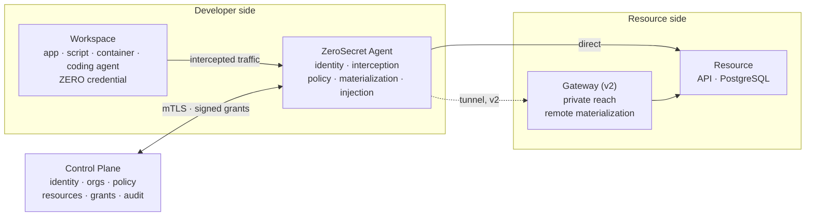
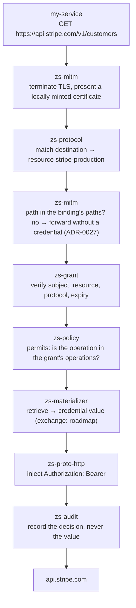
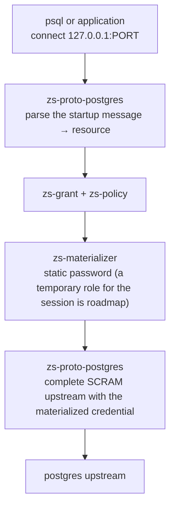
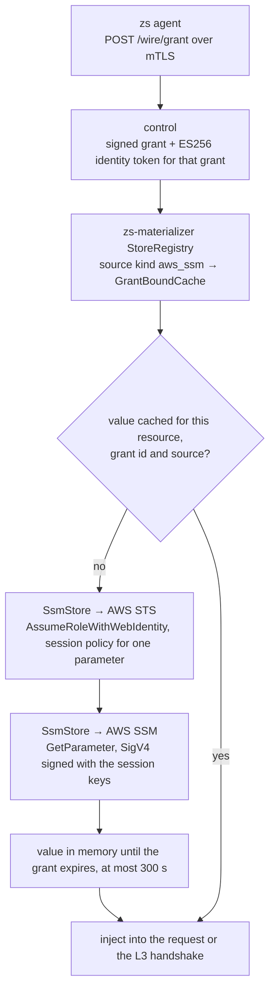
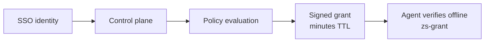
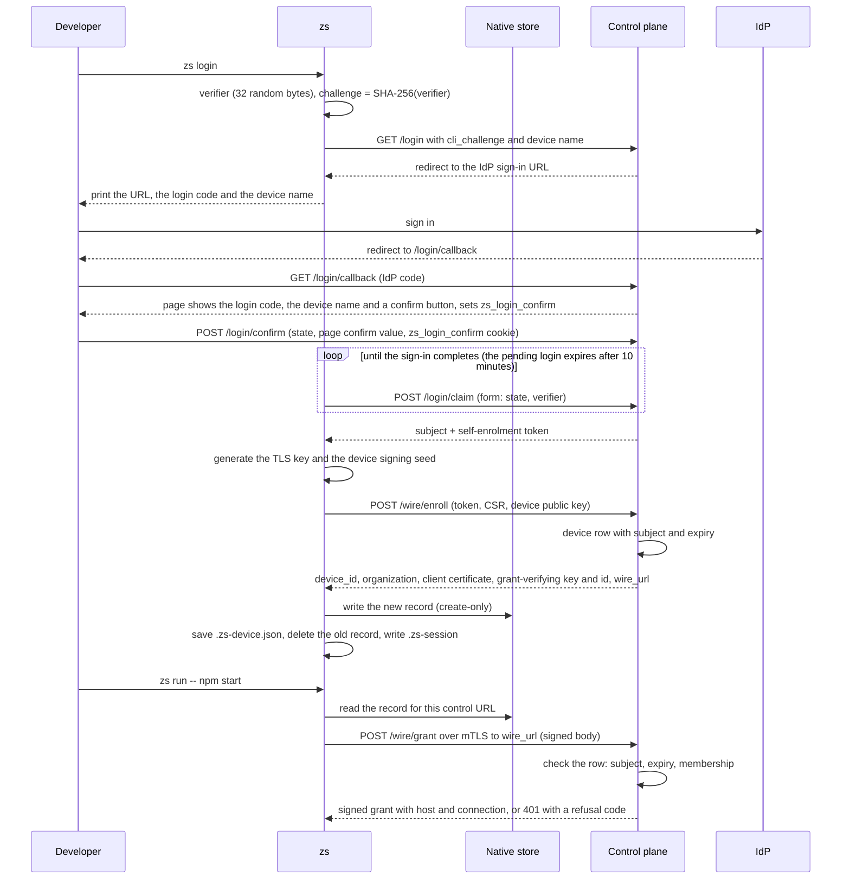
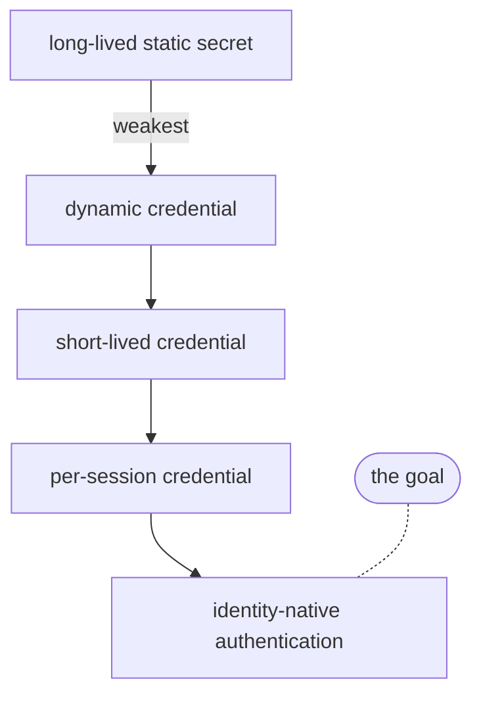

# ZeroSecret Architecture

**Status:** Approved direction
**Date:** 2026-09-05
**Owner of:** planes, crate layout, module contracts, data flow, budgets

> Product scope → [PRODUCT.md](PRODUCT.md)
> Threat model and documented limits → [SECURITY.md](SECURITY.md)

## 1. Planes

Four components. Three trust boundaries. Never one binary.



**Workspace** — where application code runs. Zero credential access. No SDK. No
awareness that ZeroSecret exists.

**Agent** — runs at the *workload's network boundary*, not "on the laptop". Laptop, dev
VM, remote workspace, and CI runner are the same rule. The agent is never inside the
application container and never inside the project directory.

**Control plane** — issues identity, owns configuration, evaluates policy, mints signed
grants, ingests audit. It is a SaaS component operated by ZeroSecret.

**Gateway** — v2. Runs adjacent to a resource that the developer cannot reach directly.
Solves connectivity, and lets materialization happen on the resource side so the
credential never reaches the developer's machine at all.

**No gateway binary ships in v1.** There is no `apps/gateway` workspace member and nothing
in v1 builds or deploys one. An earlier prototype was quarantined to
a spike (not published) at step 25; its README names four defects that make it
unsuitable as a trust boundary, and v2 rebuilds rather than hardens it.

Materialization is a **capability**, not a binary. It runs at either trusted boundary.

## 2. Workspace

This repository is the open-source engine (ADR-0050), and the paths below start at its root.
The commercial layer — the Go control plane in `control/`, the dashboard, and its Go
end-to-end suite `control/e2e` — is a separate private repository, which pins a released
tag of this repository (ADR-0051). No commercial source file is tracked here.

```
crates/
  zs-vectors           golden vector files: one format, one index, one meta-check
  zs-identity          `Subject` and `WorkloadLabel`: the non-empty identity strings
  zs-diag              per-run diagnostic events: typed, best-effort, never a credential
  zs-credential        the credential types: `CredentialRef`, `Credential`, `IdentityToken`.
                       Provider adapters (Vault, OpenBao, AWS SM, GCP SM, 1Password) are roadmap
  zs-policy            the policy reference evaluator: Cedar over a fixed policy set (ADR-0040),
                       and `permits`, the operation check the agent runs on each request. The
                       control plane decides with `cedar-go` (ADR-0048 D3)
  zs-grant             signed grant: control mints, agent and gateway verify
  zs-protocol          protocol trait: match, authorize, inject
  zs-upstream          upstream connect for the L3 listeners and zs-mitm; TLS verification and
                       leaf pin for the L3 listeners;
                       `http`: the one outbound HTTP client (rustls on ring, explicit timeouts,
                       no redirects, explicit proxy policy)
  zs-wire              control <-> agent JSON DTOs (ADR-0011)
  zs-proto-http        bearer, basic, api-key header, query param; `sigv4::sign` for AWS calls
  zs-proto-postgres    wire protocol, SCRAM, upstream TLS negotiation. The dynamic role is not implemented
  zs-proto-mysql       wire protocol, native and caching_sha2 auth, upstream TLS negotiation
  zs-proto-mongo       wire protocol, SCRAM-SHA-1/256, one-member replica set view, upstream TLS
  zs-proto-redis       wire protocol, RESP framing, AUTH and HELLO AUTH rewrite, upstream TLS
  zs-materializer      grant -> usable credential (retrieve; exchange is not implemented: the
                       agent wires `UnconfiguredExchange`, which refuses); `StoreRegistry`
                       routes the grant's source kind (`file`, `aws_ssm`) to one store and never
                       falls back; `SsmStore` reads AWS SSM through STS web identity;
                       `GrantBoundCache` keeps a value for its grant, at most 300 s
  zs-audit             append-only, hash-chained, redacting
  zs-mitm              local CA, certificate minting, TLS termination, HTTP/1 through hyper,
                       device record store
  zs-test-keychain     test-only: disposable macOS keychain interlock and exact cleanup
  zs-test-idp          test-only: fake OpenID Provider shared by control and zs tests
  zs-test-aws          test-only: fake STS and SSM with independent verifiers, p256 token signer
  zs-conformance       protocol conformance suite: cases, fake SigV4 upstream, report; no zs-* dependency

apps/
  zs                   CLI and agent daemon, one binary
```

The control plane is a separate Go module in `control/` in the commercial repository. It
serves the JSON wire API and the dashboard from one binary:

```
control/
  cmd/control          process entry: configuration, migration, listeners, shutdown
  internal/            one package per responsibility
  migrations/          the PostgreSQL schema
  vectors/             control-plane golden vectors
  css/                 the dashboard stylesheet
```

The process can open a third listener (`ZS_CONTROL_METRICS_ADDR`) that serves only
`GET /metrics`, and it can serve one organization per request host
(`ZS_CONTROL_ORGANIZATIONS`). The host is resolved before any dashboard or login handler runs;
`GET /healthz`, `GET /ca` and `POST /wire/enroll` answer on any host, because a load balancer
does not know the tenant and an enrolment token names its organization.

| Package | Owns |
|---|---|
| `internal/config` | environment and listener configuration |
| `internal/server` | `chi` routing, listener startup, mTLS, `GET /ca` |
| `internal/metrics` | the Prometheus text exposition and its own listener |
| `internal/tenant` | the organization selected by the request host, and its IdP |
| `internal/store` | PostgreSQL: `sqlc` queries, startup migration, per-run test schemas |
| `internal/wire` | `/wire/*` handlers and wire authorization |
| `internal/session` | login, OIDC callback, logout, session authorization, CSRF |
| `internal/dashboard` | operator pages and mutations, `templ` templates and the stylesheet |
| `internal/policy` | `cedar-go` evaluation over the fixed policy set |
| `internal/grant` | canonical grant payload, Ed25519 signing |
| `internal/federation` | identity-token signing, JWKS, OIDC discovery |
| `internal/oidc` | relying-party client and ID-token verification |
| `internal/keyfile`, `internal/signing`, `internal/ca` | key material: 0600 key files, grant key, device CA |
| `internal/secret`, `internal/wirejson` | redacting secret types, the wire JSON codec |
| `internal/vectortest` | the vector runner the Go tests share |

Trust boundaries are owned by [SECURITY.md](SECURITY.md).

`zs-conformance` reaches one implementation through a shell adapter
(`crates/zs-conformance/src/adapter.rs`, `adapters/zerosecret.sh`), so its case bodies name
no product. `src/cases/` holds the four protocol families, `src/runner.rs` derives the
negative controls and writes the matrix, `src/fake_upstream.rs` verifies SigV4 signatures
against the vendored vectors in `vectors/aws-sig-v4-test-suite/`, and
`tests/conformance.rs` holds the extraction seam. The crate has no `zs-*` dependency, so
extraction is `git mv`.

Inside `crates/zs-mitm`, `http1.rs` owns the byte layer: the hyper server and client
builders, the fixed replies, the conversion between `hyper::Request` and
`zs_protocol::InjectedRequest`, and the guard that refuses a target with a fragment.
`pipeline.rs` owns one request pipeline for both entry points: `Authorize` (scope and the
identity check), `Inject` (the only caller of `materialize` on the request path; the
`/.zs/presign` route calls it directly) and `Forward` (the upstream send and its one retry).
An upstream connect tries every resolved address through `zs-upstream` (2 s each, 5 s in
total). The upstream and the client TLS handshakes each have 10 s, a client request head 30 s,
and an upstream response head 600 s, the request timeout of common LLM API clients. A late
upstream answers 502 `upstream unreachable`; a late client is disconnected. The forwarded
`Host`, which a signing scheme signs, names the origin host, and the upstream port when the
binding reaches that same host on a non-default port. `proxy.rs` keeps classification, the audit and diag
vocabulary, and the entry-point plumbing (ADR-0039). `ca.rs` owns `LocalCa`:
certificate minting and the public load entry points. Secure CA storage is private to `ca/platform/`. One shared engine decides
every transition; each adapter only reads, writes a new record after an absence check,
deletes the exact macOS legacy item, and classifies native results.

| Module | Owns |
|---|---|
| `platform/mod.rs` | Compile-time dispatch to one adapter per supported OS; the fixed `secure CA storage unsupported` error elsewhere |
| `platform/record.rs` | The versioned, bounded record codec; CA reconstruction; key and certificate validation |
| `platform/state.rs` | The directory lock, `.ca-storage-id`, the fail-closed transition engine, including migration order, and the conditional retire |
| `platform/macos.rs` | The default keychain through `/usr/bin/security`: the lock check, exact items, bounded calls, the legacy item |
| `platform/linux.rs` | The Secret Service default collection over an encrypted D-Bus session (`dbus-secret-service`) |
| `platform/windows.rs` | Credential Manager generic credentials (`windows-sys`) |

`zs-mitm` declares its native dependencies per target: `dbus-secret-service` with
`crypto-rust` for Linux, and `windows-sys` with `Win32_Security_Credentials` for Windows.
macOS adds no native crate. Storage rules, failure behaviour and limits are owned by
[SECURITY.md](SECURITY.md) §6; the persistence choice is [DECISIONS.md](DECISIONS.md)
ADR-0023. `device_store.rs` writes, reads and deletes the device record through the same
adapters, under its own service (§4, ADR-0036).

Inside `apps/zs`, `main.rs` owns argument parsing, subcommand selection, and exit mapping.
`run.rs` owns the agent startup sequence: `prepare` (configuration, subject, audit journal,
CA, grants and control-plane enrolment), `start_services` (proxy and listeners, owned by
one task set that aborts on drop), `build_child` and `wait_for_child`, then audit
shipping. `login.rs` owns `zs login`, `zs logout` and the device line of `zs status`.
`device.rs` owns the native device record codec and `.zs-device.json`. The CA phase is one
isolated `LocalCa::load_or_create_secure` call inside `prepare`. It runs before the async
runtime, control-plane enrolment, any listener, any background task, and the child, so a CA
failure exits 1 with nothing to release. No shipped path calls the plaintext
`LocalCa::load_or_create`.

**A language-neutral spec and golden vectors hold the engine and the control plane in
step.** A vector lives next to the code that owns its contract: `crates/zs-grant/vectors/`,
`crates/zs-policy/vectors/`, `crates/zs-wire/vectors/`, and `control/vectors/` in the
commercial repository for federation, dashboard forms, OIDC ID tokens, and URL and
identifier rules. A vector is a JSON file with `about`, a `version`, and `cases`; each case
pins exact bytes, an exact error text, or an exact status code. Every directory has an
`INDEX.json`, and a meta-test in each language fails when a listed file or case did not run,
or when a file is not listed. Rust reads a vector with `include_str!`; Go reads it by a path
relative to its module, so the Go tests run only inside the commercial repository. A
changed vector is a contract change: the engine workspace and the commercial suite must
both be green before the pin moves. The spec owns the wire schema (ADR-0048 D7); `zs-wire`
is the agent's implementation of it.

**Dependency rule:** `apps/` depends on `crates/`. Crates never depend on apps. A crate
may depend only on crates listed **above** it; every dependency must appear strictly
earlier. The list above is a topological sort of the real graph.

`MAP` in `apps/zs/tests/dependency_rule.rs` is the authority; the list above mirrors it.
Five tests enforce this in CI: the order really is a topological sort, every named crate
exists, every workspace member is covered, members are unique and match, and the
`workspace = true` line under each `[lints]` table is not mistaken for a dependency.
Corrected 2026-09-11 — the previous ordering was violated by its own specification
(`zs-materializer` above `zs-credential`, `zs-protocol` above `zs-credential`).

`zs` and `control` deploy independently because their trust boundaries are unrelated, and
the v2 `gateway` will be a third for the same reason. Only the first two exist in v1.

The dashboard is server-rendered inside `control/` — `templ` templates and one inline
stylesheet, served by a shared shell. No npm, no bundler, no client framework, no second
type declaration of `Resource`, `Policy`, `Grant`, or `AuditRecord`. See
[DECISIONS.md](DECISIONS.md) ADR-0009.

Corrected 2026-09-17: this section previously named **htmx and Tailwind via its standalone
CLI**. Neither was ever used — `grep -rn 'htmx\|tailwind' control/` returns nothing. A
build-step dependency named in the architecture but absent from the code is the drift
ADR-0008 exists to prevent.

## 3. Request lifecycle

HTTP:



PostgreSQL:



The client's own authentication to the local listener is the ZeroSecret session, not a
database password.

A resource with an `aws_ssm` source (ADR-0041, ADR-0043), first use after a grant is minted:



The AWS session is kept per resource and role and refreshed 60 s before it expires. A
revocation or a source change drops the session and the value.

## 4. Signed grants

The agent does not call the control plane on every request. It verifies a signed grant
offline, which is what makes a control-plane outage a bounded degradation rather than a
total one (ADR-0004).



```
subject         alice@company.com
workload        claude-code
resource        stripe-production
host            api.stripe.com
protocol        https
upstream_host   api.stripe.com
upstream_port   443
upstream_tls    default
local_endpoint  false
credential      <reference, never a value>
operations      [GET, POST]
environment     development
expires_at      2026-09-05T14:12:00Z
```

Signed by the control plane. Verified by `zs-grant` in the agent.

**The grant names the upstream connection (ADR-0038).** The control plane signs resolved values
from the resource's `connection` block, so `upstream_host` and `upstream_port` are never empty.
At startup, `zs run` compares each binding with its grant before any listener or child starts.
A binding field that is set must equal the signed value. A field that is left out takes it:

| Binding field | Signed | Note |
|---|---|---|
| `host`, `protocol` | yes (ADR-0037) | must equal the grant |
| `upstream_host`, `upstream_port` | yes | may be left out |
| `upstream_plaintext`, `upstream_ca`, `upstream_cert_sha256` | yes, as one `upstream_tls` mode | may be left out, except `upstream_ca` when the mode is `ca-sha256`: the CA bundle stays a file, and only its SHA-256 is signed (`zs ca-sha256 <file>`) |
| `local_endpoint` | yes | may be left out |
| `auth`, `listen_port`, `paths`, `auth_source`, `client_auth_plugin` | no | local; SECURITY §3 says why |
| `user` | no | local. On `mongo`, the SCRAM user. On `postgres` and `mysql`, the only user a client may name; the agent refuses another before materialization. On `redis`, the user the agent authenticates as; a client may name only it, or `default` when the binding has no `user` (SECURITY §3) |

The connection is fixed for the life of the run. A renewed grant with another connection is
skipped, and a request whose grant differs is denied. For https and http, a CONNECT to a port
that is neither the signed port nor the protocol default is denied. An admin sets the values in
the dashboard. A binding that sets a non-default value stops after the upgrade until the admin
sets it, and the stop line names the field.

A grant carries a credential **reference**, never a credential value. Materialization
happens after verification, inside the data plane.

Revocation lag is bounded by the **refresh interval**, not by grant TTL (ADR-0018). An
agent that cannot reach the control plane falls back to the TTL bound, because it cannot
learn of a revocation until it next connects. Both bounds are documented in
[SECURITY.md](SECURITY.md) §3, not hidden.

**Implementation status, 2026-09-13 — stated rather than implied.** The control plane
mints and signs grants, evaluates policy before minting, and verifies device signatures
(`control/`, steps 7–11 of the v1 plan). `zs-grant::verify` checks signature, expiry,
subject, workload, resource, and operation against a canonical payload.

**The agent consumes grants (step 14).** `apps/zs` authorizes every request against a
verified, control-minted grant — no local policy file, no fail-open fallback. Its config
file carries resource-to-host bindings and pinned verifying keys only, and confers no
authority (ADR-0017). The offline-verification property described above is a property of
the running agent, not only of the crate.

**Grant revocation exists (step 22, ADR-0018).** `POST /wire/revoke` records a withdrawal
durably; the agent fetches the list on its normal refresh and refuses a revoked grant
before its expiry. Expiry is therefore no longer the only revocation mechanism. An
operator revokes a grant ID from the dashboard (`POST /grants/revoke`). The refresh loop
renews a grant before it expires, never a revoked one, and revoking any grant in a renewal
chain stops the session (ADR-0026).

**Each request is authorized for its method (ADR-0026).** A binding lists its operations.
The agent checks the request method against the signed grant on every request.

**The subject in the tuple is the signed-in one.** With a stored enrolment, `zs run` uses the
subject of that enrolment, which the control plane wrote on the device row (ADR-0036). Without
one, it uses the session in `.zs-session`, and `$USER` only when there is no session: the
offline path. `/wire/grant` refuses a request subject that is not the row subject. The SSO half
completes through `POST /login/claim` with a form body, so the verifier never sits in a URL that a
log records. The OIDC callback lands in a browser, and the CLI that started the flow would
otherwise never learn who signed in.

**Tenancy is two nested scopes (2026-09-17).** Organization carries the isolation boundary:
policy, grants, audit and revocation are all organization-scoped, and cross-tenant access is
denied on every `/wire/*` route. Project subdivides an already-isolated tenant — a resource
may name one, and a device enrolled into one reaches only that project's resources.

Both scopes are read from the **device's enrolment row**, never from the request body and
never from the client certificate's `O=` field: the body is the caller's own claim, and a
certificate can outlive a device being moved. Both are fixed by the same single statement
that consumes the enrolment token, so there is no window in which one is known and the
other is not.

A resource carrying **no** project is organization-wide and reachable from anywhere in its
tenant, which is what every policy written before project scoping is. A **device** carrying
no project is not the mirror of that: it reaches only unprojected resources, because absent
scope must not become a wildcard.

### Key rings and rotation

Three keys rotate independently: the grant signing key, the federation key and the device CA.
Each is a ring in `ZS_CONTROL_CA_DIR`, with one state file per kind (`keyring-<kind>.json`) that
names the active entry and the published entries. `control keys add|promote|retire|list` edits the
ring; the running control plane rereads it every 10 seconds, so no restart is needed.

A new key is published for 10 minutes before it may be promoted, and a demoted key signs for its
grace period before it may be retired: 320 seconds for the grant and federation keys (one
300-second lifetime plus two 10-second reloads, because an instance signs with the demoted key
until its next reload), 7 days plus 1 hour for the device CA, so every certificate that CA signed
has expired. Device certificates are
not reissued in place; a device gets a certificate from the new CA at its next `zs login`.

The agent does not need a new control-plane address: the 60-second revocations response carries the
published grant keys and CA certificates. The agent verifies a grant under any published key and
trusts any published CA at the wire handshake. An absent or empty set leaves its current set
unchanged, and a set with one invalid entry is rejected whole. The published CA set is the whole
wire trust: once a CA is retired and drops out of the set, the agent stops trusting it, even when
it is the CA pinned at enrolment. A device enrolled before `v0.4.0` has no stored CA set, so the
pinned CA is its set of one until the first refresh.

A device that is offline for the whole 10-minute publish window of a new device CA misses it: after
the promotion its wire handshake fails. It recovers by saving the control plane's current CA
(`GET /ca`) as its `control-ca.crt` and running `zs login` again.

Every control instance must read the same `ZS_CONTROL_CA_DIR`. Instances with separate copies
publish different key sets, and a device that refreshes from one drops the key the other promoted.

The procedure, on the control host:

```bash
# 1. publish the new key; every agent learns it at its next refresh
control keys add grant            # or: federation, ca
# 2. wait 10 minutes, then make it active
control keys promote grant control-k2
# 3. wait the grace period, then drop the old key and its files
control keys retire grant control-k1
```

`control keys promote federation` also reads `<ZS_FEDERATION_ISSUER>/.well-known/jwks.json` and
refuses until the hosted JWKS holds the new `kid`, so upload the `oidc-export` files first. It
also refuses when `ZS_FEDERATION_ISSUER` is not set in its environment. After `retire federation`,
run `oidc-export` again and upload the result, so the hosted JWKS drops the retired key. A refused
command changes no file. Two `control keys` commands on one kind run one after the other (a lock
file beside the state). `control keys list <kind>` prints ids, states and times only. The grant
and federation graces are 320 seconds; the device CA grace is 7 days and 1 hour.


### Device enrolment and stored identity

`zs login` enrols a device once. Later `zs run` commands load that enrolment from the native
store and `$ZS_HOME/.zs-device.json` (`ZS_HOME` defaults to `$HOME`). The decision is
[DECISIONS.md](DECISIONS.md) ADR-0036. The trust boundaries and limits are in
[SECURITY.md](SECURITY.md) §3 and §6.



If the save of `.zs-device.json` fails, `zs login` deletes the new record. One enrolment exists
for each control URL. A second `zs login` against the same control URL replaces it.

The native record:

| Part | Value |
|---|---|
| Service | `zerosecret.device.v1` |
| Account | `zs-device-<device_id>` |
| Value | `ZSDV`, version byte `1`, u32 big-endian length of the TLS key PEM, the TLS key PEM, the 32-byte device signing seed |

`.zs-device.json` holds public data only, mode 0600, written to a temporary file and renamed.
It is `{"enrolments": [...]}` with at most one entry for each control URL. Each entry has:

| Field | Value |
|---|---|
| `control` | Control URL, without a trailing `/` |
| `control_ca_sha256` | Lowercase hex SHA-256 of the control CA PEM, with every `\r` removed and outer whitespace trimmed |
| `subject` | Subject from the SSO sign-in |
| `device_id` | Device id from `/wire/enroll`. It names the native record |
| `organization` | Organization of the device |
| `client_certificate` | Client certificate PEM for `/wire/*` |
| `grant_verifying_key_hex` | Pinned grant-verifying key (ADR-0016) |
| `grant_verifying_key_id` | Its key id |
| `wire_url` | Where `zs run` sends `/wire/*` requests |

## 5. Interception layers

The escalation is chosen **per resource** and declared in resource configuration. It is
never a global mode.

| Layer | Mechanism | Used when |
|---|---|---|
| L1 | Explicit proxy — `HTTPS_PROXY` injected into the child process | Default. Dev containers work immediately |
| L2 | Process-scoped `zs run <cmd>` — child environment plus local CA trust | The SDK ignores proxy variables. Validated 2026-09-06 by the synthetic hostname-routing probe and verifier (spike evidence, not published): an unchanged Node/Stripe fixture completes the mapped path with TLS verified on both legs, and the fail-closed controls held. Caveat carried from the probe: SDKs honor `HTTPS_PROXY` when a user or tool sets one, so the managed workspace must clear or pin proxy variables |
| L3 | Protocol listener — a local TCP socket per resource | PostgreSQL, MySQL (ADR-0029), MongoDB (ADR-0031), Redis (ADR-0057) and every future non-HTTP protocol |
| L4 | Transparent TUN | Deferred. Only when L1–L3 cannot hold the invariant |

Always use the least invasive mechanism that satisfies the invariant.

The child's environment carries the run's credential (ADR-0052). `HTTPS_PROXY`, and
`HTTP_PROXY` when the run has an http binding, is `http://zs:<run token>@<addr>`, and
`ZS_<RESOURCE>_URL` is `http://<addr>/<run token>`. The proxy checks `Proxy-Authorization` on
every request, and the endpoint strips the first path segment before it matches, signs or audits.
`/.zs/presign` strips the token from the URL it re-signs too, so a URL a client presigned on
`ZS_<RESOURCE>_URL` comes back without it. No line on stdout and no `listener_bound` event
carries the token.

This is not a system-wide proxy. Browsers, banking sites, and unrelated applications are
untouched. ZeroSecret is not Zscaler and must never be described as though it were.

Known hard ground, planned for rather than promised away: certificate pinning, Java and
custom trust stores, container networking, remote workspaces, HTTP/2, HTTP/3 and QUIC,
gRPC, mTLS upstreams, native clients that ignore proxy settings, VPNs, corporate proxies,
EDR products. WebSockets and SDK request signing were on this list and are solved for the
named schemes: a WebSocket binding writes the credential into one JSON field of client
messages (ADR-0034), and `aws-sigv4` re-signs, `hmac-body-signature` and `api-key-header`
inject, on the agent (ADR-0035, ADR-0046).

**HTTP/1.1 only, enforced rather than assumed (2026-09-11).** `zs-mitm` pins ALPN to
`http/1.1` on both the client-facing and upstream legs. An h2-capable client is
negotiated down rather than silently mis-framed — the failure mode where injection does
not happen and nothing denies. HTTP/2 stays on the hard-ground list above; when it is
taken on, the pin is what has to change. hyper reads and writes the framing on both legs
(ADR-0039). The proxy still decides what crosses: a request whose `Transfer-Encoding` is
not exactly one `chunked` is refused, a body over 32 MiB is refused, and a head over
64 KiB is refused (`crates/zs-mitm/src/http1.rs`).

## 6. Materialization modes

| Mode | Meaning | Strength |
|---|---|---|
| Retrieve | Pull a stored credential from a vault | Works everywhere. Weakest |
| Exchange | Identity to ephemeral credential: AWS STS, OAuth token exchange, temporary database role. Not implemented: the agent wires `UnconfiguredExchange` (`apps/zs/src/run.rs`), which refuses | Preferred wherever the provider supports it |

Mode is a property of the resource and is visible to the user. The long-term product
story is moving resources from Retrieve to Exchange:



The data model carries `materialization.mode` and `materialization.location`
(`agent` | `gateway`) from day one. Applications never see either.

## 7. Authorization is a tuple

Not a credential lookup.

```
human identity + workload identity + destination + protocol operation + environment + session
```

```
alice + claude-code + api.stripe.com + GET    + development → ALLOW
alice + claude-code + api.stripe.com + DELETE + production  → DENY
```

When a binding lists `paths`, the destination includes the request path. A path outside
the list gets no credential and needs no grant (ADR-0027).

This converts credential possession into runtime authorization. It is the differentiator.

**v1 limit, stated honestly:** workload identity is a declared label
(`zs run --as claude-code`) plus process lineage. It is not cryptographic and does not
resist a hostile local process. The agent's listener binds to loopback, which every local
account can reach, so any local account that can reach the port gets the developer's
access, not only processes of the same user. Caller authentication is planned. See
[SECURITY.md](SECURITY.md).

## 8. Configuration source of truth

The control plane owns configuration. There is no committed `zerosecret.yaml`. The committed
`run` block in `zs-policy.json` holds control-plane connection settings only; the control plane
still owns resource configuration (ADR-0036), including each resource's upstream connection
(ADR-0038).

The agent keeps a read-only cache of the last-known resource configuration and grants so
a network blip does not stop work. The cache expires with the grant TTL. Past that, the
agent fails closed.

Rejected: a second self-managed configuration path. It doubles the surface, doubles the
test matrix, and creates drift between what the dashboard shows and what the agent
enforces.

## 9. Engineering constraints

- Units: milliseconds, bytes. UTC everywhere. No local time in any stored value.
- Determinism: seeded RNG only in tests. No wall-clock reads outside an injected clock.
- Failure isolation: a broken protocol implementation denies its own resource. It never
  takes down the agent.
- Fail closed: unknown resource, unverifiable grant, expired cache, or unavailable audit
  sink all mean deny.
- Redaction: a credential value never reaches a log line, an audit record, an error
  message, or a panic payload. Credential types do not implement `Debug` or `Display`.

### Persistence and migration

PostgreSQL startup runs the numbered files in `control/migrations/` (`NNNN_name.sql`, embedded
through `go generate ./internal/store`) with `store.ApplyMigrations`. One transaction takes
`pg_advisory_xact_lock(7239001)`, creates `schema_migrations` if absent, runs each file whose
version is not recorded, in ascending order, as a single argument-less `Exec`, and records the
version. Concurrent control-plane instances queue on the lock, so each file runs once and the
instances do not rely on `IF NOT EXISTS` being atomic. A file that fails rolls the whole run
back: no partial schema and no recorded version. A migration that has shipped is never edited
except to keep it re-runnable; a schema change is a new numbered file. An installation that
ran `0001` before the runner existed runs it once more, so `0001` must stay idempotent.
`store.createSchema` is the one place that still tolerates concurrent creators, only for
`23505`, `42P07` and `42710`. Do not broaden that set.

Schema changes use `ALTER TABLE ... ADD COLUMN IF NOT EXISTS`. Required columns are
backfilled with a default and then have that default removed. A nullable value such as
`project_id` remains nullable; migration must not invent a scope.

The enrolment-token column stores a SHA-256 digest. A legacy plaintext value is no longer
usable against the digest and must fail closed. Upgrade coverage includes
`store.TestMigratingAPreProjectSchemaAddsTheProjectColumn`; a fresh-schema
test alone is not evidence that an existing installation upgrades correctly.

Database test schemas use a per-run timestamp plus counter so concurrent runs do not reuse
state. The persistence migration tests intentionally use fixed schema names and isolate
their rows with per-run identifiers.

## 10. Budget

| Path | Budget |
|---|---|
| HTTP request added latency, warm grant | < 6 ms p95 |
| Agent resident memory, idle | ≤ 60 MB |
| Agent cold start to first proxied request | ≤ 400 ms |

Measured by a benchmark in CI, not by assertion. A change that regresses a budget fails
the build.

**These are budgets for an idle measuring host**, and the added-latency one is the reason
that needs saying. Added latency is the proxied p95 minus the direct-request median on
the same machine. The budget has about 3 ms headroom over the proxy's ~3 ms median;
scheduler preemption on a busy developer host can still consume that headroom without
a change to the proxy.

**Before treating a local `budget_latency` failure as a regression, check `proxied p50`.**
If the median is ~3 ms the proxy is behaving and the host is the variable; a real regression
moves the median, and a 4 ms sleep injected on the proxy path fails the test at ~12 ms.

**`budget_footprint` has the same sensitivity**, observed 2026-09-18: it failed immediately
after three back-to-back `cargo test --workspace` runs had driven the load average to 12.6,
and passed on the same binary once the machine settled to 3.5. **Do not run the budget gates
straight after a full workspace run** — they measure wall-clock, and the suite that just
finished is still the load.
