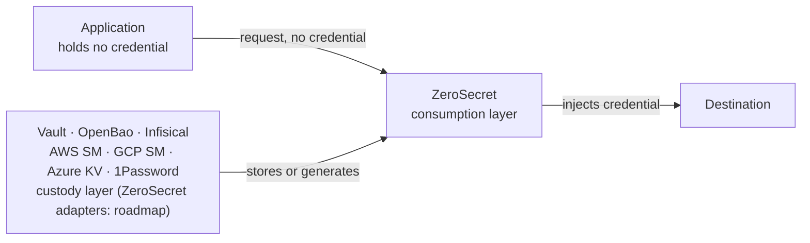

# ZeroSecret Product Specification

**Status:** Approved direction
**Date:** 2026-09-05
**Owner of:** invariant, category, claims, non-goals, buyer, editions, pricing

> Architecture → [ARCHITECTURE.md](ARCHITECTURE.md)
> Security model → [SECURITY.md](SECURITY.md)
> Sequencing → [ROADMAP.md](ROADMAP.md)
> Irreversible choices → [DECISIONS.md](DECISIONS.md)

## 1. The invariant

An application protected by ZeroSecret never retrieves, receives, stores, configures,
or is aware of its upstream credential. Credentials are materialized only inside a
trusted ZeroSecret data-plane boundary, after identity-based authorization, and
injected directly into the protocol exchange.

Every feature must serve this sentence. A feature that does not, does not ship.

This is a violation of the product, not a feature of it:

```js
const key = await zerosecret.get("STRIPE_KEY");
```

That is a secret manager with a nicer client. ZeroSecret is the layer that stops the
secret manager from delivering anything into the workload at all.

## 2. Category

**Secretless development runtime.** The mechanism underneath is identity-bound
credential brokering.

The product promise:

> Your code can use credentials it never possesses.

The sales sentence:

> Sign in once with SSO. ZeroSecret authenticates your development workloads to APIs,
> databases, and services without putting credentials in `.env`, application memory,
> or agent context, on every path ZeroSecret intercepts, with an audit record that never holds the credential.

ZeroSecret is the credential **consumption** layer. Vaults are the credential
**custody** layer. They are different products.



## 3. Non-goals

ZeroSecret is not, and will not become:

- A secret manager, vault, or rotation product.
- A privileged access management product.
- An infrastructure access platform.
- A general egress proxy, API gateway, or tunnel.
- An identity provider.
- A DLP or traffic inspection product.

The company runs one product. The webhook delivery product is out of scope for this
repository and is not a shared roadmap.

## 4. The demo

Five minutes, no slides. This is the acceptance test for the whole product.

```bash
env | grep -E 'STRIPE|OPENAI|DATABASE'      # nothing

zs login                                     # SSO, company IdP
zs run npm dev                               # app calls api.stripe.com. it works.

cat /proc/<pid>/environ | grep -i stripe     # nothing
psql "$DATABASE_URL"                         # connects. no password anywhere.
```

Then ask a coding agent inside that workspace to print every environment variable and
file it can read. Still no key. The API call still works.

**Claim discipline (2026-09-06):** the demo claim is verifier-backed, not literal. The
SDK requires a key-shaped input, so `STRIPE_API_KEY` carries a fixed public,
non-authorizing placeholder; the claim is that a verifier proves no real credential
exists in any observed workload surface (environment, files, argv, memory, outputs) and
every planted synthetic leak is detected. The empty-variable demo above is the v1
strict-mode target, not the shipped v0 claim.

**Executed 2026-09-17 against a real third party that validates.** Evidence:
the v1 demo transcript (not published). The host is
`auth-staging.acme.example`, not Stripe — the criterion is *a real key against a counterparty
that refuses a wrong one*, and this one does. Both directions were run through `zs run`
with the same command, only the credential differing:

| Credential the agent injected | Upstream's answer |
|---|---|
| the real access token | **200** `{"scope":["all"],"client_id":"acme"}` |
| a wrong token | **401** `{"message":"invalid_token (CODE: 0)"}` |

`zs-verify` reports `leaked: false` over a scan that reached the upstream
(`upstream_requests: 1`), with four of five vectors complete and all `found: false`; the
fifth needs forced core dumps, unavailable on macOS.

**Strict mode was recorded as NOT met on 2026-09-17; that was the label, not the result.**
The evidence above — **no credential in the workload's environment, files, or arguments**,
verified in the same child that made the authenticated call — is exactly what §7's strict
definition asks. The old implementation read the label off the materialization mode, saw
`retrieve`, and printed `not-strict`. ADR-0022 decides strictness by interception instead,
and this resource reports `strict` on the same evidence, with no new run needed.

Then sign in as a developer without the policy grant. Same source tree, same machine,
same command:

```
zs: denied — bob@company.com has no grant for stripe-production
```

## 5. Buyer

Not individual developers. Individuals believe `.env` works and will not pay.

The buyer is platform engineering, security engineering, developer infrastructure, or
DevSecOps at an organization where developers currently hold shared API keys,
developer database passwords, cloud credentials, and tokens copied out of a password
manager.

First-customer profile: 50–500 engineers, software-heavy, heavy external API and
database use, security-conscious but without a complete internal identity platform.
Fintech, payments, B2B SaaS, security vendors, AI companies, regulated startups (especially those needing to meet EU AI Act, SOC 2, or NIST AI RMF compliance).

Avoid Fortune 100 first. Procurement and security review will outrun product-market fit.

## 6. Competitive position

| Product | What it owns | How ZeroSecret differs |
|---|---|---|
| Infisical Agent Proxy | AI agent credential brokering at the network boundary | ZeroSecret starts from human SSO identity and covers every development workload, not the agent alone |
| StrongDM | Privileged access to infrastructure — SSH, K8s, databases | ZeroSecret targets outbound dependencies of a workload, not operator access to infrastructure |
| Teleport | Infrastructure and workload identity platform | ZeroSecret stays narrow. Competing on breadth loses |
| Vault / OpenBao | Credential custody, dynamic secrets | ZeroSecret is meant to consume them. Integration, not replacement. The provider adapters are roadmap: today a source is a file or AWS SSM |
| CyberArk Secretless Broker | Protocol connectors that keep credentials from the app | Closest technical ancestor. ZeroSecret adds identity, policy, delegation, and audit |
| Auditors / Compliance | Manual evidence gathering for SOC 2, EU AI Act, NIST AI RMF | On an intercepted path the workload never holds the upstream credential, and the audit record shows each decision without the value. That is evidence for an access-control review, not a proof and not a compliance certification (§7) |

Do not fight Infisical on "AI agent secrets proxy". Do not fight Teleport on breadth.
Do not fight Vault on custody.

The defensible claim is the one none of them make:

> The developer workspace has an identity. The workloads inside it do not inherit its
> secrets.

## 7. Claims discipline

<!-- CLAIM-FENCE-START -->

**Safe:** ZeroSecret removes standing credentials from supported local source trees,
`.env` files, shell startup files, and runtime configuration.

**Safe, strict mode:** on an intercepted path, the workload gets access without receiving
the upstream credential.

**Unsafe, never make it:** "no secret in any process, for any stack." "Developers never
manage credentials again." "Every action in every stack is checked and logged."

Every resource reports which interception layer and which materialization mode it uses.
A resource that cannot reach strict mode is labelled as such in the CLI and dashboard.
Marketing copy carries the same scope as this section.

<!-- CLAIM-FENCE-END -->

**The reporting obligation above is implemented and tested (2026-09-17).** It had not been:
`zs resources` printed the materialization mode and nothing else, and the dashboard did the
same, so a user could not tell which of their resources reach "safe, strict mode" — the
distinction this section exists to keep honest.

```
$ zs resources
stripe-production  api.stripe.com  https     L1  retrieve  strict
analytics-db       db.internal     postgres  L3  exchange  strict
session-cache      cache.internal  redis     -   exchange  not-strict
```

The `exchange` rows are an illustration of the report format. Exchange materialization is
roadmap and not implemented (the agent refuses it), so a real resource reports `retrieve`
today.

**Strict is decided by interception, not by materialization (2026-09-18, ADR-0022).** This
section's definition asks *who holds the credential*, and both interception layers answer it
the same way: `zs-mitm` terminates TLS and injects on the upstream leg, `PostgresListener`
completes SCRAM upstream and relays. The workload holds nothing in either case. Until this
date the implementation answered a different question — which materialization mode was used
— and labelled the HTTPS path `not-strict` for a property it did have.

Materialization is orthogonal: it decides *what* credential is presented, not *who holds
it*. `exchange` is still better for other reasons — a short-lived, narrowly-scoped, upstream-
revocable credential limits the damage if the **agent** is compromised — and those reasons
are not what this section's strict definition measures.

The intercepted protocols are **enumerated, not negated**: a resource on a protocol no layer
carries reports `not-strict` and no layer at all, **and the agent refuses it** rather than
proxying it. A free-form protocol with an `else` branch would label `redis` strict by
omission, which is the overclaim this section exists to prevent. A resource with no grant
reports `strict-unknown`, never `strict`, for the same reason: absence of evidence is not
evidence.

The claim is bounded to an **intercepted path**, and SECURITY §3 already documents that
bound. A workload that ignores the proxy variables is not intercepted, receives no
credential — so the claim survives — and simply fails. No new limit is added here.

**The label must be true of the code, and checking only the printed line is how that was
missed once already.** Every reporting test passed while `AgentHandler::from_grants` still
proxied an unintercepted protocol and injected its credential — found by running the binary,
not by the suite, and closed by
`apps/zs/tests/fail_closed.rs::a_protocol_no_layer_carries_is_denied_rather_than_proxied`.

Nine tests in `apps/zs/tests/claims_reporting.rs`, one in
the commercial repository's dashboard tests, and one in
`apps/zs/tests/https_validating_upstream.rs` that joins the label to the evidence: the
resource reporting `strict` is the one whose child environ holds no credential while the
call is accepted. **A label is a claim; the child's environ is the evidence** — asserting the
printed label alone would pass against an implementation that prints `strict` and leaks. The
CLI and dashboard reports must agree; a resource labelled strict in one place and not the
other would be worse than no label at all.

**§4's claims, 2026-09-17.** Four of the five lines now run against a counterparty that
**validates the credential** — a real PostgreSQL that refuses a wrong password, an HTTPS
upstream that answers 401 to a wrong bearer token, and a real OIDC flow with RS256 verified
against a fetched JWKS. Each has a negative test, without which the positive one would pass
against a counterparty that accepts anything. That was the actual state until this date:
the httpbin demo echoed whatever it was given, proving delivery and not acceptance.

**The "real third-party API" wording is now verified (2026-09-17).** It was the last gap:
every counterparty before this date ran on the developer's own machine — they validated,
but they were not somebody else's service.

`auth-staging.acme.example` is. Through `zs run`, same command, only the credential differing:
the real access token gives **200** `{"scope":["all"],"client_id":"acme"}` and a wrong one
gives **401** `{"message":"invalid_token (CODE: 0)"}`. `zs-verify` reports `leaked: false`
over a scan that reached the upstream. Evidence:
the v1 demo transcript (not published).

**What that supports, stated at the width the evidence carries:**

| Claim | Status |
|---|---|
| **Safe** — no standing credential in the workload's environment, files, or arguments | ✅ verified against a third party that validates |
| **Safe, strict mode** — the workload gets access without receiving the upstream credential | ✅ verified on the intercepted path |

**This row read ❌ until 2026-09-18, and the reason it changed is a corrected label, not a
new mechanism.** The demo resource materializes as `retrieve`, and the old implementation
read that as not-strict. The evidence was already in the repository: the same `zs-verify`
run that proves the **Safe** row shows the credential absent from the child that made the
authenticated call, which is exactly what this section's strict definition asks. The demo
resource now reports `strict`.

The claim is scoped to intercepted paths — HTTPS through `zs-mitm`, PostgreSQL through
`PostgresListener`, MySQL through `MysqlListener`, MongoDB through `MongoListener`. It is not
a claim about unintercepted traffic, not a claim that the agent is a sandbox (SECURITY §3's
local-process limit is narrowed to the OS user, not removed: every listener authenticates its
caller, except the Windows database listeners, and a process of that user can still read the run
token from the child's environment and gets the developer's access, ADR-0052), and strict mode reduces credential theft to session
abuse rather than providing isolation. See ROADMAP's v1 status block.

## 8. Edition boundary

Security enforcement is open and inspectable. Customers are installing a binary that
terminates TLS, holds identity, and handles credentials. Security engineers will ask
what it does. The answer must be "read it".

| Open source | Commercial |
|---|---|
| Agent, CLI, MITM engine, protocol implementations, materializer, policy evaluator, audit primitives; credential source adapters (AWS SSM is the one shipped source; the other providers are roadmap) | Hosted control plane, organizations, SSO federation, policy distribution, central audit and export, dashboard, gateway, device posture, approvals, SLA |

Never monetize the vault. The pitch is "keep your existing secret manager, stop it
delivering secrets into developer processes" — a far easier sale than "replace Vault".

## 9. Pricing, starting position

Billed per **active human developer**. Their delegated workloads are included.

| Tier | Price |
|---|---|
| Individual | Free |
| Team | $10–15 / active developer / month |
| Business | $25–35 / active developer / month |
| Enterprise | Custom |

Never bill per request. Never bill per AI agent — an engineer running a coding agent, a
local service, and a test worker must not become four billable identities.

SSO is not an enterprise upsell. Identity is the product; putting basic OIDC behind an
enterprise wall breaks the value proposition.
