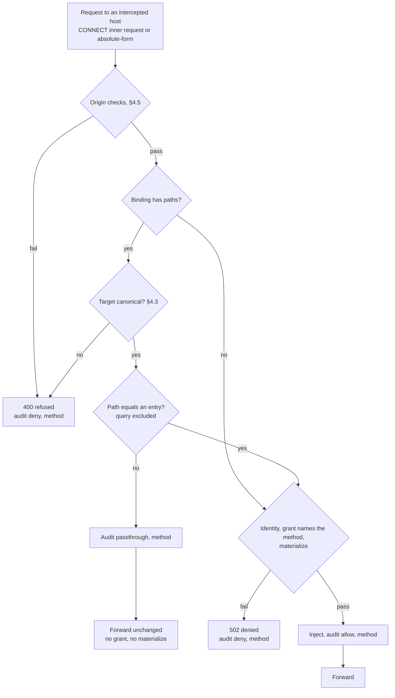
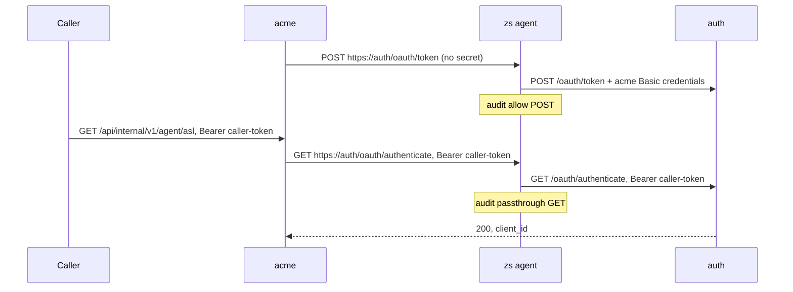

# Per-path injection scope — design (2026-10-03)

- **Status:** draft for owner review. No code exists.
- **Sources:**
  - acme `zerosecret/FINDINGS.md`, integration note 4 and H12;
  - acme run `zerosecret/.run/20261003T012652Z`;
  - ADR-0017 (local file carries no authority), ADR-0022, ADR-0026 (methods, framing).
- **Plan:** the implementation plan (not published)
- **Decision record:** ADR-0027, written by the plan's docs task.

Amended 2026-10-29 on the owner's instruction: customer names, customer infrastructure identifiers and references to unpublished files replaced; the design is unchanged.

## 1. Problem

An HTTPS binding injects its credential into every request to its host. Acme uses one host,
auth, for two jobs with different authentication.

| Call | Acme source | Authentication | Correct agent action |
|---|---|---|---|
| Acme's own token exchange | `src/apis/services/toolRequest.ts:19`: `POST {TOOL_OAUTH_URL}/oauth/token` | Acme's Basic client credentials | Inject the brokered credential |
| `checkClientAuth` | `src/apis/middlewares/authClient.ts:8`: `GET /oauth/authenticate` | The caller's own bearer token | Forward the request unchanged |

Today the agent replaces the caller's bearer token with acme's client credentials. Auth
answers `invalid_token`. Thus auth refuses every caller, and legitimate callers too.

Evidence from run `20261003T012652Z`:
- H12 result: acme status 400, `invalid_token (CODE: 0)`, `authGetAllows: 1`.
- `acme.log` lines 254–268: `oauth middleware error: … invalid_token`.
- `audit-acme.jsonl`: each auth `GET` has decision `allow`, so the agent injected the credential.

A second fault is in the harness, found while reading that evidence. Acme's axios sends
absolute-form requests. Each one writes two records: `allow connect`, then `allow <METHOD>`.
S1, H5 and H6 count `allow` records with no operation filter. H5's `authAllows: 2` includes the
`connect` record. After this change that record exists even with no valid grant (§5.4), so
H5 could report REFUTED for the wrong reason. §9 corrects the filters.

## 2. Goal, non-goals, success criteria

**Goal.** A binding can name the request paths that get the brokered credential. Other
paths on that host go to the upstream without the credential and with the client's own
headers.

**Non-goals.**
- Prefix or glob paths (§4.2).
- Paths in the signed grant or in control-plane policy (§3).
- Path scope on PostgreSQL bindings.
- The request path in an audit record (§5.5).
- Paths in `zs resources` or on the dashboard.

**Success criteria.**
1. Acme-auth has `paths: ["/oauth/token"]`. Through `zs run`, a caller with a real auth token
   passes `checkClientAuth`, and auth refuses a caller with a fake token (acme scenario S6).
2. Acme's token exchange is still brokered: S1 PASS with an `allow POST` record for auth.
3. A request gets the credential only when its path is byte-equal to a scope entry. The
   agent refuses every ambiguous request target before it opens an upstream connection.
4. SECURITY §7 has rows 16–19. Each row has a passing `row_NN_` test.
5. Every gate in the plan passes.

## 3. Decision 1: where the scope lives

| | A: local binding (`paths`) | B: signed grant and policy rule |
|---|---|---|
| Who sets it | Developer, in the agent file | Operator, on the dashboard |
| Effect | Narrows credential release. Never widens it | Narrows release. The operator can force it |
| Changes | `ResourceBinding`, `zs-mitm` | Also `zs_grant::Grant`, signed encoding, `zs-wire`, control DB migration, policy evaluation, dashboard form |
| Already-signed grants | Unchanged | Need a compatibility rule |

**Recommendation: A.**

1. **A only narrows.** The signed grant still decides the resource and the methods. If a
   developer removes `paths`, the agent injects on every path. The grant already
   authorizes that. Thus an edit of the local file gives no authority that the signature
   does not give. ADR-0017 has the same rule: the local file carries no authority. ADR-0026
   has the same pattern: the binding lists methods, and the signed grant is checked.
2. **The need is workload correctness.** Acme needs the caller's token to pass. The
   developer who reads acme's code knows which call uses the brokered credential. The
   operator does not.
3. **A is small.** The grant format, the wire, the database and the dashboard do not change.
4. **B can come later without a change to A.** If a grant carries paths, the agent injects
   only on a path in both sets. A binding without `paths` then means "the grant's paths".

**Cost of A.**
- The operator cannot force a path limit. A developer can return to host-wide injection,
  within the grant.
- The dashboard does not show the scope. ARCHITECTURE §8 wants the dashboard to show what
  the agent enforces. The binding file is already local (ADR-0017, ADR-0026), so this is not
  a new kind of drift. It adds one field to it.

**Reverse when** an operator must limit a credential to paths that the developer must not
widen. Then add B as an intersection.

## 4. Decision 2: matching

### 4.1 What the agent matches

- The agent matches the request target of each request, as the proxy parsed it, before
  injection.
- The proxy builds the upstream request line and headers again from the parsed values
  (`serialize_request`). Thus the upstream gets the same method, target and `Host` that the
  decision used.
- The agent splits the target at the first `?`. It matches only the part before. The query
  goes to the upstream unchanged.
- The compare is case-sensitive and byte-for-byte. RFC 3986 §6.2.2.1 makes the path
  case-sensitive. A case-sensitive compare can only miss an injection, and a miss releases
  nothing. A case-insensitive compare could inject on `/OAUTH/TOKEN`, which a
  case-sensitive upstream can route to a different handler.

### 4.2 Exact only

- Each `paths` entry is an exact path. A request is in scope only when its path equals an
  entry.
- Acme needs exact paths. No caller needs a prefix today (AGENTS.md: no new abstraction
  until the third caller).
- A prefix or a glob must agree with the upstream's path normalizer. Exact compare with
  refusal (§4.3) does not need that agreement.
- An entry must not contain `*`. Thus a later prefix form, for example `/v1/*`, is
  additive: no config that is valid today changes its meaning.
- A trailing `/` is significant: `/oauth/token/` is not `/oauth/token`. Some routers
  (Express without `strict`) treat them as equal. Then the agent does not inject on
  `/oauth/token/`, and that only misses an injection.

### 4.3 Canonical or refused: the agent never rewrites a path

The agent classifies the target. It compares a canonical target. It refuses a target that
is not canonical, because that target is ambiguous.

Why the agent does not normalize and then match: the attack is a difference between two
normalizers.
- Tomcat removes `;` parameters, so `/v1/..;/admin` is `/admin` there. A simple parser sees
  a segment `..;`.
- nginx merges `//`, and some configurations decode `%2F` before routing.
- A server that decodes twice changes `%252F` into `/`.

If the agent and the upstream normalize differently, the credential goes to a path that
the binding did not name. If the agent refuses every form that two parsers can read
differently, the agent does not need to agree with the upstream.

Rules for a binding with `paths`:

| Item | Rule | Reason |
|---|---|---|
| Form | The target starts with `/` (origin-form). Otherwise refuse | §4.5 also applies this to every intercepted request |
| Query | Split at the first `?`. Match only the part before it | The query is not the path |
| `#` | Refuse | A client never sends a fragment on the wire |
| Characters | Permit only `A–Z a–z 0–9 - . _ ~ ! $ & ' ( ) * + , = : @ / %`. Refuse all other bytes: `;`, `\`, space, control bytes, `" < > ^` `` ` `` `{ \| } [ ]`, non-ASCII | `;` starts path parameters (Tomcat, Jetty, Spring). `\` is a separator on IIS and on some frameworks |
| `%` | Two hex digits must follow. Otherwise refuse | Parsers read a bad escape differently |
| `%2F %5C %2E %25 %3B %3F %23` in any case, `%00`–`%1F`, `%7F` | Refuse | These decode to a separator, a dot, a percent (double decoding), a parameter, a query, a fragment or a control byte |
| All other `%XX` | Keep. Compare as bytes | An entry has no `%` (§4.4). Thus a segment with `%` never equals an entry segment. `/oauth/%74oken` goes to the upstream without the credential |
| Dot segment | Refuse a segment that is `.` or `..` | An upstream that removes dot segments sees a different path |
| Empty segment | Refuse `//` at any position. Permit the root `/` and one trailing `/` | nginx and others merge `//`. Some URI parsers read `//x` as an authority |

### 4.4 Rules for an entry (config load)

- An entry starts with `/`. It obeys every rule in §4.3. It contains no `%`, `?`, `#` or `*`.
- `paths` has one entry or more. The agent refuses `paths: []`, because an empty list can
  mean "no path" or "every path".
- Only an HTTPS binding can have `paths`.
- The binding refuses unknown fields (`#[serde(deny_unknown_fields)]`). Without this, a
  misspelled `path` is ignored, and the agent injects on every path. That is the fault this
  design removes.
- An error names the resource and the index of the bad entry.

### 4.5 Origin checks on every intercepted request

The scope is a set of paths on one origin. The `Host` header and an absolute-form target
inside a tunnel can name another origin on the same server: a virtual host or a CDN
front. Thus:

- **Absolute-form request to the proxy.** The URI authority is the target. The proxy
  removes every client `Host` header and sends `Host: <authority>` (RFC 9112 §3.2.2). It
  omits the port when the port is 443.
- **Request inside a CONNECT tunnel.** The CONNECT authority is the target.
  - The target must be origin-form. The agent refuses `*`, an absolute-form target and an
    authority-form target.
  - The request must have exactly one `Host` header.
  - Its host, compared without case, and its port (443 when absent) must equal the CONNECT
    authority. A trailing dot is a mismatch.
  - Otherwise the agent refuses the request.

These checks apply to bindings with and without `paths`. On a binding without `paths`, a
`Host` for another origin sends the credential to that origin's virtual host on the same
server. A correct client never sends such a request. The owner can limit the checks to
scoped bindings (§13).

### 4.6 Refusal response and audit

- Response: `HTTP/1.1 400 ZeroSecret refused an ambiguous request`, `Content-Length: 0`,
  `Connection: close`. The text is fixed. It never repeats the target, because a target
  can contain a secret.
- Audit: decision `deny`, operation = the request method.
- The agent opens no upstream connection and does not materialize a credential.

## 5. Decision 3: requests outside the scope

### 5.1 Forward through the MITM

The agent forwards an out-of-scope request through the MITM. The client side uses the
local CA certificate, the same as for an in-scope request. The upstream side uses the
binding's TLS rule (ADR-0026) and the same upstream connection reuse.

A raw tunnel is not possible. In a CONNECT tunnel the agent knows the path only after it
terminates TLS. One kept-alive connection can also carry in-scope and out-of-scope
requests one after the other.

### 5.2 The client's headers stay

The agent does not call `Protocol::inject`. The client's `Authorization`, `Cookie`, API-key
headers and query stay unchanged. The agent applies only the rules that it applies to every
forwarded request:
- framing (ADR-0026): it removes `Proxy-Connection` and hop-by-hop headers and sends one
  `Content-Length`;
- origin (§4.5): it sends the `Host` of the target origin.

### 5.3 No credential

The agent does not call `FlowHandler::materialize`. No credential value enters agent
memory for an out-of-scope request.

### 5.4 No grant is necessary

**Recommendation:** an out-of-scope request needs no grant.

- A grant authorizes the use of a credential. An out-of-scope request uses none.
- An unbound host needs no grant (§7 row 1). An out-of-scope path is the same case.
- A grant check gives no security here. A developer can remove the binding (ADR-0017), and
  the workload can then reach the host directly.
- A grant check would make availability depend on the grant. A revoked or expired grant
  would also stop acme's `checkClientAuth`, which never uses the brokered credential.

**Consequences.**
- `AgentHandler::classify` does not call `authorized_for_any` for a binding with `paths`.
  It returns `Flow::Intercept`.
- The grant check runs for each in-scope request, in `materialize(resource, method)`. That
  code does not change.
- The identity check at CONNECT (`authorize_request`) does not change.
- For a scoped binding, a missing, expired or revoked grant gives a `deny` record per
  in-scope request, with the method as operation. The CONNECT-time `deny` with the reason
  text does not occur. Per-request denials already omit the reason (ADR-0026).

**Rejected alternative:** keep the CONNECT-time grant check. It changes less code, but a
grant failure also stops all out-of-scope traffic.

### 5.5 Audit record

For each out-of-scope request the agent writes one record:
- decision `passthrough` (an existing value);
- operation = the request method;
- resource `host:port`, the same as today.

The agent writes the record before it forwards the request, as SECURITY §5 requires. If the
write fails, the agent refuses with `502 audit unavailable` (§7 row 7).

Why not a new decision value: `passthrough` already means "forwarded without a
credential". A new value changes `zs_audit::Decision`, the wire ingest, the control
database and the dashboard. The operation tells the two cases apart: a host passthrough
writes `connect`, and a path passthrough writes the method.

Why no path in the record: a path can contain personal data or a token, for example
`/reset/<token>`. Records go to the control plane. `allow` and `deny` records do not carry
the path either.

The interception record (`allow`, operation `connect`) does not change. It records that the
agent terminates TLS for the host. It does not record a credential release. A reader that
counts credential use must filter on the method (§9).

## 6. Decision 4: paths and methods

The agent decides each request in this order: origin checks (§4.5), then scope (§4.3), then
method (ADR-0026). For a binding with `paths`:

| Path | Method and grant | Result |
|---|---|---|
| Ambiguous | Any | `400`. Audit `deny` |
| Out of scope | Any | Forward without the credential. Audit `passthrough` |
| In scope | Valid grant names the method | Inject. Audit `allow` |
| In scope | Grant does not name the method | `502`. Audit `deny` |
| In scope | No valid grant | `502`. Audit `deny` |

- `operations` applies only to in-scope paths.
- The agent still requests the grant for the binding's `operations`. `run.rs` does not change.
- There are no per-path methods. No caller needs them.
- Acme-auth becomes `paths: ["/oauth/token"]`, `operations: ["POST"]`. Acme no longer needs
  `GET` on auth, because `/oauth/authenticate` is out of scope. This is narrower than the
  `["GET", "POST"]` that ADR-0026 recorded for acme.

## 7. Decision 5: the CONNECT and absolute-form flows

Both flows use one per-request decision at the same point: after the head and the body
are read, before the identity check, materialization and injection.



Acme after the change:



Insertion points in `crates/zs-mitm/src/proxy.rs`:

| Flow | Function | Point |
|---|---|---|
| CONNECT | `serve_intercepted` | In the request loop, after `read_body`, before the inject closure |
| Absolute-form | `handle_absolute` | In the `Flow::Intercept` branch, after the `allow connect` record, before the inject closure |

Interfaces:

```rust
pub enum PathScope {
    Host,
    Paths(Vec<String>),
}

pub enum ScopeDecision {
    Inject,
    Forward,
    Refuse,
}

pub enum ScopeError {
    Empty,
    NotCanonical { index: usize },
}

impl PathScope {
    pub fn from_entries(entries: Option<&[String]>) -> Result<Self, ScopeError>;
    pub fn decide(&self, target: &str) -> ScopeDecision;
}

pub enum Flow {
    Intercept {
        resource: String,
        upstream_host: String,
        upstream_port: u16,
        upstream_tls: bool,
        scope: PathScope,
    },
    Passthrough,
    Deny { reason: String },
}
```

- `PathScope` lives in a new module, `crates/zs-mitm/src/scope.rs`. It is pure code with no
  I/O and no new dependency. `zs-mitm` owns HTTP/1 handling (ARCHITECTURE §2).
- `PathScope::Host` returns `Inject` for every target. Thus a binding without `paths` keeps
  today's behaviour.
- `serialize_request` takes the target authority. It removes client `Host` headers and
  writes `Host: <authority>`. The CONNECT flow passes the CONNECT authority, not
  `upstream_host`, so a test upstream override does not change `Host`.

## 8. Configuration

```json
{
  "resource": "acme-auth",
  "host": "auth-staging.acme.example",
  "protocol": "https",
  "auth": { "scheme": "basic" },
  "operations": ["POST"],
  "paths": ["/oauth/token"]
}
```

- `ResourceBinding` gets `paths: Option<Vec<String>>` and `path_scope()`. It also gets
  `#[serde(deny_unknown_fields)]`.
- `AgentFile::load` validates each binding with `path_scope()`, next to the existing
  `upstream_tls()` check. A bad scope stops the load.
- `AgentHandler::classify` calls `path_scope()` again and denies on an error. This is the
  same pattern as `upstream_tls()`, because tests build `AgentHandler` without
  `AgentFile::load`.
- A `postgres` binding with `paths` fails at load. `ResourceBinding::path_scope()` does this
  check, because `zs-mitm` does not know the binding protocol.

## 9. Acme harness changes

| Change | File |
|---|---|
| Acme-auth gets `"paths": ["/oauth/token"]` and `"operations": ["POST"]` | `zerosecret/config/resources.json` |
| Carry `paths` from the config to the binding | `zerosecret/lib/envsplit.cjs`, `zerosecret/lib/bindings.cjs` |
| `--bearer-file <file>`, so the real token is never in `argv` | `zerosecret/lib/acmecall.cjs` |
| S6 replaces H12 | `zerosecret/lib/scenarios.sh`, `zerosecret/lib/report.cjs` |
| S1 counts `allow` with `--operation POST` | `zerosecret/lib/scenarios.sh` |
| H5 and H6 use `trigger_auth` (`POST /oauth/token`) and count `--operation POST` | `zerosecret/lib/scenarios.sh` |
| S1n counts `allow` with method `POST`, and S2 with `GET`. A CONNECT to a scoped host writes `allow connect` with no injection | `zerosecret/lib/verdicts.cjs` |
| Result and integration note 4 | `zerosecret/FINDINGS.md` |

**Scenario S6: a real caller passes `checkClientAuth`.**
1. S6 runs after S1. Redis db 2 key `acme:tool-oauth-token` then holds the auth access token
   that acme got through the agent. S6 writes it to `$SECRET_DIR/auth-caller.token`, mode
   0600. It never prints the token or puts it in a result.
2. Positive call: `acmecall GET /api/internal/v1/agent/asl --bearer-file <file>`. It passes
   when all of these are true:
   - `acme.log` gets one new `(client_id: <id>) GET /api/internal/v1/agent/asl` line;
   - after the floor, auth has one `passthrough GET` record or more;
   - after the floor, auth has zero `allow GET` records.
3. Negative control: `acmecall GET /api/internal/v1/agent/asl --bearer zs-e2e-not-a-real-token`.
   It passes when all of these are true:
   - acme answers 4xx;
   - `acme.log` gets a new `oauth middleware error` line and no new `(client_id:` line;
   - after the floor, auth has one `passthrough GET` record or more and zero `allow GET`.
4. Verdict:
   - PASS only when both calls pass;
   - SKIPPED only when acme-auth is not brokered;
   - FAIL in every other case, with the evidence of both calls.

**Discrimination check.** Run `--quick` once with the pre-change acme-auth config: no `paths`,
`operations: ["GET", "POST"]`. S6 must FAIL: the positive call gets `invalid_token`, and auth
has an `allow GET` record. Then restore the config. Without `paths` and with only `POST`, the
positive call fails for a different reason (method denial), so that config proves nothing.

**Rerun.** Unset `DOCKER_CONTEXT`. The default context is `colima-zerosecret-db` again, and
it has free disk space. Do a full run, because H5 needs a session older than the grant TTL.

## 10. SECURITY §7 rows and matrix tests

| Row | Condition | Result | Test in `apps/zs/tests/fail_closed_matrix.rs` |
|---|---|---|---|
| 16 | Request path outside a binding's `paths` | Forward without a credential. Keep the client's headers. No grant needed. Audit `passthrough` with the method (ADR-0027) | `row_16_a_path_outside_the_scope_is_forwarded_without_a_credential_or_a_grant` |
| 17 | Ambiguous request target on a binding with `paths` | Refuse before the upstream. Audit `deny` with the method (ADR-0027) | `row_17_an_ambiguous_request_target_is_refused_before_the_upstream` |
| 18 | `Host` missing, repeated or for another origin, or a target that is not origin-form, inside a tunnel to a bound host | Refuse before the upstream. Absolute-form: the URI authority replaces `Host` (ADR-0027) | `row_18_a_request_for_another_origin_is_refused_or_rewritten` |
| 19 | `paths` empty, not canonical or on a non-HTTPS binding, or an unknown binding field | Refuse the config at load. Never fall back to host-wide injection (ADR-0027) | `row_19_an_invalid_scope_or_binding_field_refuses_the_config` |

`every_security_7_row_has_a_named_test_in_this_file` changes from 15 rows to 19.

Rows 2, 3, 6, 10 and 12 stay true for a binding without `paths`. For a binding with
`paths`, they apply to in-scope requests, per request. Row 16 states the other half.

## 11. Other documentation changes

| File | Change |
|---|---|
| `docs/DECISIONS.md` | ADR-0027: scope on the binding, exact paths, refuse ambiguity, no grant outside the scope, origin checks. Reversed by B as an intersection |
| `docs/SECURITY.md` §5 | One paragraph: a path passthrough writes `passthrough` with the method; `allow connect` records interception, not release |
| `docs/SECURITY.md` §7 | Rows 16–19 |
| `docs/ARCHITECTURE.md` §3 | HTTP lifecycle diagram: a scope node before `zs-grant` |
| `docs/ARCHITECTURE.md` §7 | One sentence: the destination includes the path when the binding has `paths` (ADR-0027) |

PRODUCT §7 does not change. An out-of-scope request carries the workload's own credential,
not a brokered one. Strict mode is about the brokered credential.

## 12. Test strategy

Detail is in the plan. Every test is written first and seen to fail.

| Level | Where | Covers |
|---|---|---|
| Unit | `crates/zs-mitm/src/scope.rs` | Each §4.3 row, exact match, query, case, trailing `/`, entry rules |
| Unit | `crates/zs-mitm/src/proxy.rs` tests | Tunnel `Host` match table; absolute-form `Host` rewrite in `serialize_request` |
| Config | `apps/zs/tests/fail_closed_matrix.rs` row 19 | §4.4 load errors, `deny_unknown_fields`, `classify` denial of a bad scope |
| Agent | `apps/zs/tests/fail_closed.rs` with `common::setup_agent_with` | Real binary, both flows, client headers kept (`last_head`), no grant, no materialize, smuggling table, paths × methods, keep-alive mix, `Host` |
| Matrix | `apps/zs/tests/fail_closed_matrix.rs` | Rows 16–19 |
| Harness | acme `node --test zerosecret/test/*.test.cjs` | S6 verdicts, operation filters, `paths` in bindings, `--bearer-file` |
| End to end | acme `zerosecret/run-e2e.sh` | S1, S6 and H5/H6 against auth-staging |

Each security test does positive activity before an absence assertion, and has a negative
control (AGENTS.md).

## 13. Decisions the owner can reverse

| Decision | Recommended | Alternative | Cost to switch later |
|---|---|---|---|
| Scope location | Local binding (A) | Signed grant (B) | B is additive as an intersection |
| Out-of-scope grant | Not required | Required at CONNECT | Small: keep `authorized_for_any` for scoped bindings |
| Origin checks | Every intercepted request | Scoped bindings only | Small: one condition |
| Matching | Exact | Prefix `/x/*` | Additive: `*` is invalid today |
| Unknown binding fields | Refused | Ignored | Small, but a typo again gives host-wide injection |

## 14. Risks

- **Over-refusal.** A client that sends `;`, `%2F` or `//` to a scoped binding gets `400`.
  Only scoped bindings are affected. The `400` and the `deny` record make it visible.
- **Acme's own token at `/oauth/authenticate`.** S6 uses acme's own auth token as the "real
  caller" token. Auth can refuse it for a reason that is not ZeroSecret, for example an
  audience rule. Then S6 fails on its positive call. The plan stops and reports this. It
  does not weaken the verdict.
- **Origin checks on unscoped bindings.** A client that sends a `Host` without its non-443
  port is refused. No test fixture or harness client does this.
- **Less reason text.** For a scoped binding, an expired or revoked grant gives `deny` with
  only the method. H5 and H6 judge a `deny POST` after an earlier `allow POST`.
- **The `allow connect` record stays.** A counter without an operation filter overcounts
  credential use. The acme harness changes in §9 add the filter.
