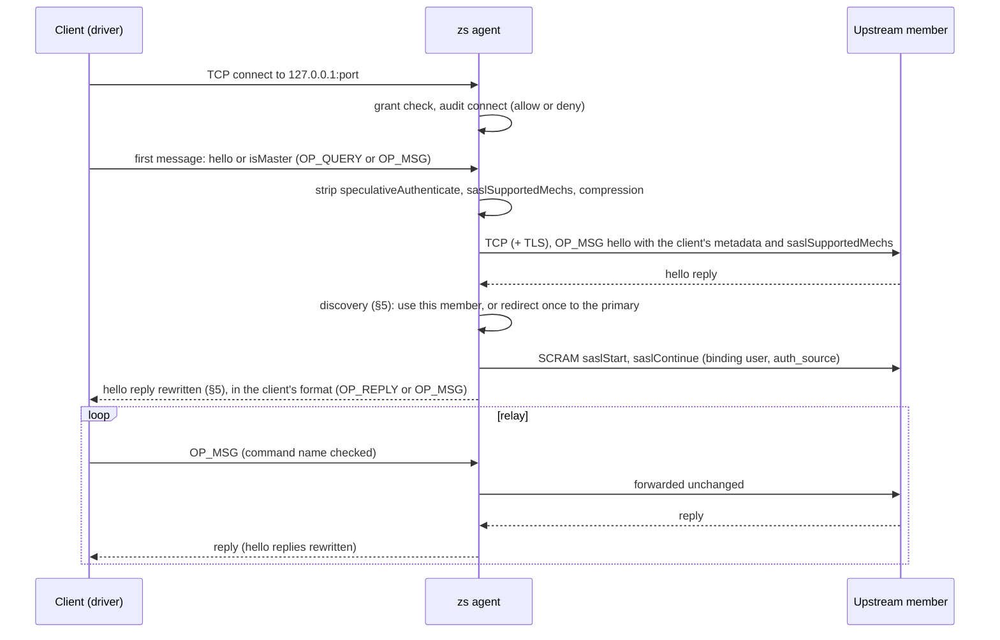

# `zs-proto-mongo` — design (2026-10-11)

- **Status:** draft for owner review.
- **Owner decisions (2026-10-11):**
  - MongoDB is the next protocol after MySQL (ADR-0029 order);
  - the agent shows the driver a replica set with one member, the loopback listener (§5);
  - the owner told the agent to verify the other choices by experiment and to select the
    recommendation from the results. §2 holds the evidence. §13 lists each choice.
- **Order:** after `zs-proto-mysql` (ADR-0029) and PostgreSQL upstream TLS (ADR-0030). Before
  Redis.
- **Plan:** written after the owner accepts this spec.
- **Decision record:** ADR-0031, written by the plan's docs task.

Amended 2026-10-29 on the owner's instruction: customer names, customer infrastructure identifiers and references to unpublished files replaced; the design is unchanged.

## 1. Goal, non-goals, success criteria

**Goal.** A MongoDB client under `zs run` connects to a local listener with no user name and
no password. The agent authenticates upstream with the binding's user name and the brokered
password, then relays the session.

**Non-goals.**
- Per-command authorization. PRODUCT §3: not a traffic inspection product. The brokered
  user's roles limit what the client can do.
- Connection pooling or multiplexing. One client connection is one upstream connection.
- Reads from secondaries. All traffic goes to the primary (§5).
- `mongodb+srv` seed lists, load-balanced mode (`loadBalanced=true`), x.509, LDAP (`PLAIN`),
  Kerberos, `MONGODB-AWS`, OIDC.
- Compression on either leg. TLS on the loopback client leg.

**Success criteria.**
1. Acme starts under `zs run` and reports Mongo status `connected`, with no `MONGO_USER` and no
   `MONGO_PASSWORD` in acme's environment, files or log (acme S8).
2. With a wrong brokered password, the agent refuses the connection and relays nothing (S8n).
3. A real MongoDB 8.0 accepts the agent with SCRAM-SHA-256 and with SCRAM-SHA-1, over verified
   TLS and over plaintext.
4. The agent never sends the password. Every refusal in §9 has a `row_NN_` test.
5. Every connection leaves `zs-diag` events and one `connect` audit record.
6. After a primary step-down, the driver reconnects through the agent to the new primary.

## 2. Evidence (2026-10-11, no staging contact, no Docker)

Sources: acme's installed driver (`mongodb` 4.17.2, `mongoose` 6.13.8), a fake MongoDB server
in Node in `/tmp/zs-mongo-exp/` (outside every repository), Python `hashlib`, and public
MongoDB documents.

| Test | Result | Effect on this spec |
|---|---|---|
| T1: facade reply, client with no credentials | Topology `ReplicaSetWithPrimary`. Retryable writes carry `txnNumber`. A transaction commits | The facade works (§5) |
| T2: seed `localhost`, facade names `127.0.0.1` | The driver moves to the address in `hosts` and works | No rule on the client's host name |
| T3: facade member is not primary | Server selection times out. The monitor sends `hello` with `exhaustAllowed` (flag 65536) | The rewrite follows `moreToCome` chains (§5) |
| T4: client with credentials, agent refuses `saslStart` with code 18 | The driver sends `speculativeAuthenticate` and `saslSupportedMechs`, then `saslStart`. The app gets `MongoServerError` 18 with the agent's text | Strip and refuse (§6, row 28) |
| T5: standalone reply | Topology `Single` | Standalone passes through (§5) |
| T6: any client | The driver always sends `compression` in `hello` | Strip `compression` (§6) |
| T7: acme's `getMongo()` options with `user` and `pass` undefined | No auth command. Works | No acme code change (§11) |
| T8: driver with `tls=true` | The first 16 bytes read as length 100 729 622 and a random opcode | The frame check rejects a TLS ClientHello (§6) |
| T9: agent answers the first `hello` with code 18 | The app gets `MongoServerSelectionError: zs: upstream authentication failed` | Error replies to the first `hello` (§4) |
| T10: agent closes all 5 pinned connections under load | 60 751 inserts pass. 2 `MongoNetworkError` reach the app. The topology returns to `ReplicaSetWithPrimary` | Step-down closes pinned connections (§5) |

**Driver source (4.17.2).**
- `sdam/server.js:240`: for a server with wire version 8 or more, a `NotWritablePrimary` error
  does not clear the pool. Only a network error clears it (lines 229–231). So after a step-down,
  pooled connections to the old primary stay open unless the agent closes them.
- `cmap/auth/scram.js`: SCRAM-SHA-1 uses `hex(MD5(user ":mongo:" password))`. The driver
  refuses an iteration count below 4096. `saslStart` sends `skipEmptyExchange: true`.
- `cmap/auth/mongo_credentials.js:9-21`: with `saslSupportedMechs` in the reply, the driver
  uses SCRAM-SHA-256 when listed, else SCRAM-SHA-1. With no `saslSupportedMechs`, it uses
  SCRAM-SHA-1.
- `cmap/auth/mongo_credentials.js:126`: `user` with no password gives the password `''`.
- `cmap/connection.js:409`: the first `hello` goes as `OP_QUERY`. Later commands go as `OP_MSG`.
- Acme has no `saslprep` module. Acme's driver sends the password unchanged.

**Server rule.** The server refuses a second `hello` with `client` metadata on one connection:
error 186 `ClientMetadataCannotBeMutated`. A proxy that sends its own `hello` first and then
forwards the client's `hello` fails on every connection (NODE-3786, the `mongobetween` case).
The handshake specification says that drivers send the handshake arguments only in the first
`hello`. So the agent uses the client's first `hello` as the upstream handshake (§4).

**SCRAM vectors (Python `hashlib`, all equal to the published values).**
- MongoDB SHA-1 digest of user `user`, password `pencil`: `1c33006ec1ffd90f9cadcbcc0e118200`.
- SCRAM-SHA-1 (MongoDB auth specification): client final
  `c=biws,r=fyko+d2lbbFgONRv9qkxdawLHo+Vgk7qvUOKUwuWLIWg4l/9SraGMHEE,p=MC2T8BvbmWRckDw8oWl5IVghwCY=`,
  server signature `UMWeI25JD1yNYZRMpZ4VHvhZ9e0=`.
- SCRAM-SHA-256 (RFC 7677): client final
  `c=biws,r=rOprNGfwEbeRWgbNEkqO%hvYDpWUa2RaTCAfuxFIlj)hNlF$k0,p=dHzbZapWIk4jUhN+Ute9ytag9zjfMHgsqmmiz7AndVQ=`,
  server signature `6rriTRBi23WpRR/wtup+mMhUZUn/dB5nLTJRsjl95G4=`.

**Acme code (read only).**
- `src/apis/config/v2/connection.ts:56-72`: URI `mongodb://${MONGO_HOST}:${MONGO_PORT}/${MONGO_DB}`,
  options `user`, `pass`. No `tls`, no `replicaSet`, no `authSource`, no `directConnection`.
  So `authSource` is `MONGO_DB`.
- `src/apis/index.ts:15-20`: acme connects to Mongo at start. It starts its HTTP server only
  after the connection succeeds.
- No `readPreference` and no Mongo transaction in `src`.

## 3. Shape: a copy of MySQL L3

| Item | MySQL today | MongoDB |
|---|---|---|
| Crate | `zs-proto-mysql` | new `zs-proto-mongo` |
| Listener | `MysqlListener::bind_endpoint("127.0.0.1:0", endpoint, tls, materialize)` | `MongoListener::bind_endpoint("127.0.0.1:0", endpoint, tls, auth, materialize)`. `tls` is `Option<UpstreamTls>`: `None` is plaintext |
| Builder calls | `with_diag`, `with_refusal_audit`, `with_client_auth` | `with_diag`, `with_refusal_audit` |
| stdout line | `zs: mysql <resource> -> 127.0.0.1:<port>` | `zs: mongo <resource> -> 127.0.0.1:<port>` |
| Standard env vars | `MYSQL_HOST`, `MYSQL_TCP_PORT` | none. No MongoDB client reads a host variable |
| Per-resource env vars | `ZS_<RESOURCE>_HOST`, `ZS_<RESOURCE>_PORT` | the same |
| Credential | password; user and database from the client | password; user and `auth_source` from the binding. The client sends no auth |
| Upstream TLS | when offered, verified | always, verified, unless `upstream_plaintext` (§7) |
| Audit | one `connect` record per connection | the same, protocol `mongo` |
| Grant operation | `connect` | `connect` |
| Default upstream port | 3306 | 27017 |
| Upstream connect | `zs-upstream` `UpstreamEndpoint` | the same |

**ADR-0022 enumeration.** `InterceptedProtocol::Mongo` is added in all places that enumerate:
- `zs-protocol`: the enum, `classify_intercepted_protocol` (value `mongo` only), and the
  allowlist test (`mongodb` and `mongo ` stay refused);
- `zs-diag`: `Component::Mongo` (`mongo`);
- `apps/zs/src/main.rs`: `interception_layer` (`L3`);
- `apps/zs/src/lib.rs`: default port, operations (`connect`), field validation;
- `apps/zs/src/run.rs`: the listener loop and the per-resource env vars;
- `apps/control/src/dashboard.rs`: `interception_layer_of` (`L3`) and the protocol filter option.

## 4. Connection flow



1. **Grant.** The agent checks the grant and writes the `connect` audit record before it
   connects upstream. On a deny, the agent waits for the client's first message and answers it
   with error code 13 `Unauthorized`, text `zs: connect denied`. Then it closes.
2. **First message.** The first client message must be `hello`, `isMaster` or `ismaster`.
   Anything else is refused (row 29).
3. **Upstream handshake.** The client's first `hello` is the upstream handshake, so the
   server gets the client's `client` metadata once (§2, error 186). The agent sends it as
   `OP_MSG`, with `$db` taken from the `OP_QUERY` collection name. It removes
   `speculativeAuthenticate`, `saslSupportedMechs` and `compression`. It adds
   `saslSupportedMechs: "<auth_source>.<user>"`.
4. **Redirect.** If discovery redirects (§5), the agent sends the same `hello` on the new
   connection. That connection is new, so the metadata rule holds.
5. **Wire floor.** The agent refuses a server with `maxWireVersion` below 6 (MongoDB 3.6),
   because SCRAM goes as `OP_MSG`.
6. **Authentication.** SCRAM runs on the final connection (§7).
7. **Reply.** The agent rewrites the `hello` reply (§5). It sends the reply as `OP_REPLY` when
   the client sent `OP_QUERY`, and as `OP_MSG` when the client sent `OP_MSG`.
8. **Failure replies.** If a step after the grant fails, the agent answers the client's first
   `hello` with a fixed error and closes. The text never holds server text.
   - auth failure: code 18 `AuthenticationFailed`, text `zs: upstream authentication failed`;
   - all other stages: code 6 `HostUnreachable`, text `zs: upstream unavailable (<stage>)`, with
     `<stage>` from §10.
9. **Budget.** From accept to the rewritten reply, the agent has 15 s. When the budget runs
   out, the agent closes with stage `handshake`.
10. **Relay.** After the reply, the agent relays. It never adds a message of its own to the
    upstream connection, so request IDs cannot collide.

## 5. Topology facade

**Discovery.** The agent classifies the `hello` reply of the first upstream connection:

| Reply | Action |
|---|---|
| `ok` is not 1 | Refuse, stage `discovery`, kind `hello_error` |
| `msg: "isdbgrid"` (mongos) | Use this connection. No rewrite of hosts |
| no `setName` (standalone) | Use this connection. No rewrite of hosts |
| `setName` and `isWritablePrimary` (or `ismaster`) true | Use this connection |
| `setName`, not writable, `primary` names a member in `hosts` | Close. Connect to that member. Send the same `hello`. The reply must be writable primary with the same `setName` |
| `setName`, not writable, no `primary` | Refuse, kind `no_primary`. The driver retries within its server selection timeout |
| `primary` not in `hosts` | Refuse, kind `not_in_hosts` |
| the redirect target is not writable primary or has a different `setName` | Refuse, kind `second_redirect` or `set_mismatch`. The agent follows at most one redirect |

The server name for TLS is the host that the agent dials: the seed host, or the redirect
target from `hosts`.

**Primary state (one per listener).** The listener keeps the address of the last known primary
and a generation number (`tokio::sync::watch`).
- A new connection dials the known primary first. If its reply is writable primary with the
  same `setName`, the agent uses it (role `cached`). If not, the agent starts discovery at the
  seed.
- Each discovery that ends at a primary sets the state to that address.
- Each connection is pinned to the address it dialed. When the state changes to a new address,
  every connection pinned to a different address closes at once. When the state becomes stale,
  every connection pinned to the stale address closes at once.
- When a relayed `hello` reply says the pinned member is no longer writable primary, the agent
  marks the state stale. It forwards the reply, then closes the connection.
- Standalone and mongos connections have no state and no step-down rule.

So after a step-down the driver gets network errors on all pinned connections. That clears its
pool (§2, `sdam/server.js`). Its next connections go through discovery to the new primary. In
T10, 2 operations out of 60 751 failed during this change.

**Rewrite.** The agent rewrites each reply to a client `hello`, `isMaster` or `ismaster`
command. It finds these replies by `responseTo`. When a reply has `moreToCome`, the agent adds
that reply's `requestID` to the chain, because the next streamed reply answers it.

| Field | Replica set reply | Standalone or mongos reply |
|---|---|---|
| `hosts` | `["127.0.0.1:<listener port>"]` | not present; unchanged |
| `me` | `127.0.0.1:<listener port>` | unchanged |
| `primary` | `127.0.0.1:<listener port>` when writable primary; else removed | unchanged |
| `passives`, `arbiters` | removed | unchanged |
| `saslSupportedMechs`, `speculativeAuthenticate`, `compression` | removed | removed |
| checksum flag | cleared, CRC removed | cleared, CRC removed |
| all other fields | unchanged | unchanged |

All other replies go through byte for byte.

## 6. Message handling

**Frame check.** The agent reads the 16-byte header first. It checks the length and the opcode
before it reads the body.
- The length must be at least 16 and at most the upstream `maxMessageSizeBytes`. Before the
  upstream reply is known, the limit is 48 000 000.
- A TLS ClientHello fails this check (T8).

**Client to upstream.** The agent reads each client message in full, within the limit.

| Client message | Action |
|---|---|
| `hello`, `isMaster` or `ismaster` as the first message: `OP_MSG`, or `OP_QUERY` on `<db>.$cmd` | Upstream handshake (§4) |
| `OP_QUERY`, any other case | Refuse (row 29), reason `op_query` |
| `OP_MSG` with the checksum flag | Refuse (row 29), reason `checksum` |
| `OP_MSG` whose command is `saslStart`, `saslContinue` or `authenticate` | Error reply code 18 `AuthenticationFailed`, text `zs: authentication is brokered`. Audit `deny` `authenticate`. Close (row 28) |
| `OP_MSG` `hello`, `isMaster` or `ismaster` after the first message | Strip `speculativeAuthenticate`, `saslSupportedMechs`, `compression`. Track the reply (§5) |
| any other `OP_MSG` | Forward unchanged |
| `OP_COMPRESSED` or any other opcode | Refuse (row 29), reason `compressed` or `opcode` |

The command name is the first key of the `OP_MSG` section of kind 0. The section can come after
sections of kind 1.

**Upstream to client.** The agent reads each header. It reads in full only the replies to
tracked `hello` requests, and rewrites them. It streams all other replies without a full read.
After the handshake, only `OP_MSG` is accepted from the upstream. Any other opcode, including
`OP_COMPRESSED`, closes the connection: `upstream_failed`, stage `relay`, kind `opcode`.

**Close.** On the TLS leg, an upstream close without a TLS close_notify counts as a clean
upstream close (`closed_by` `upstream`). This is the MySQL rule.

**BSON.** The crate holds its own BSON code. It reads the elements of the top level of a
document and keeps each element as raw bytes. It knows the size rule of every BSON type. It
writes new documents for the error replies, the SCRAM commands and the rewritten replies.

## 7. Authentication and TLS

**SCRAM.**

| Item | Rule |
|---|---|
| Mechanism | From the `saslSupportedMechs` of the final `hello` reply: SCRAM-SHA-256 when listed, else SCRAM-SHA-1 when listed. With no `saslSupportedMechs`: SCRAM-SHA-1, the driver rule. A list without either: refuse (row 30) |
| Commands | `saslStart` (with `skipEmptyExchange: true`), then `saslContinue` until `done: true`. At most 3 rounds. `$db` is `auth_source` |
| SCRAM-SHA-256 password | The brokered password. If it holds a byte outside printable ASCII (0x20–0x7E), refuse with kind `saslprep`. SASLprep changes no printable ASCII text, so no new dependency is needed |
| SCRAM-SHA-1 password | `hex(MD5(user ":mongo:" password))` |
| User name | In `n=`, `=` becomes `=3D` and `,` becomes `=2C` |
| Checks | The server nonce starts with the client nonce. The iteration count is 4096 to 1 000 000. The server signature matches (constant-time compare). An `e=` attribute is an auth failure |
| Secrets | The password and all derived keys are zeroized after use |

SCRAM never sends the password. The code is a new module in `zs-proto-mongo`, generic over SHA-1
and SHA-256. The PostgreSQL SCRAM-SHA-256 code does not change. Two callers do not justify a
shared crate.

**TLS.** MongoDB does not negotiate TLS. The driver starts TLS at the first byte, or never.

| Binding fields | Upstream leg |
|---|---|
| none | TLS, webpki roots |
| `upstream_ca` | TLS, webpki roots and the PEM file |
| `upstream_cert_sha256` | TLS, the leaf must match the pin. After a redirect, the primary's leaf must match too, so a set with one leaf per member needs `upstream_ca` |
| `upstream_plaintext: true` | Plaintext. Diag `tls` result `plaintext` |

- `zs-upstream` does not change. A mongo binding maps `UpstreamTls::from_config` to
  `Some(tls)`, and `upstream_plaintext` to `None`. The listener treats `WhenOffered` as TLS with
  webpki roots.
- A TLS failure refuses the connection. The agent never falls back to plaintext (row 31).
- `upstream_plaintext` on a mongo binding is allowed for any host, not only loopback. ADR-0026
  allows it only for a loopback HTTPS upstream. The reason for the exception: SCRAM never sends
  the password. ADR-0031 records the exception.

## 8. Configuration

```json
{
  "resource": "acme-mongo",
  "host": "mongo.example.internal",
  "protocol": "mongo",
  "user": "app",
  "auth_source": "appdb",
  "upstream_plaintext": true
}
```

| Field | Rule |
|---|---|
| `protocol: "mongo"` | New enumerated value |
| `host`, `upstream_host` | The seed. The agent dials `upstream_host` when set |
| `upstream_port` | Default 27017 |
| `user` | Required on a mongo binding. Not empty. Mongo bindings only |
| `auth_source` | Optional. Default `admin`. Not empty. Mongo bindings only |
| `upstream_plaintext` | Optional. Now also allowed on a mongo binding, for any host. Not with `upstream_ca` or `upstream_cert_sha256` |
| `upstream_ca`, `upstream_cert_sha256` | Now also allowed on a mongo binding. Not both (§7) |
| `operations` | Ignored; MongoDB grants `connect` |
| `paths`, `auth`, `client_auth_plugin` | Refused on a mongo binding |

The diagnostic log and the audit log never hold `user`, `auth_source` or a host name.

## 9. SECURITY §7 rows

Rows 25–27 belong to PostgreSQL TLS (ADR-0030). The new rows are 28–32.

| Row | Condition | Result | Test |
|---|---|---|---|
| 28 | MongoDB client sends `saslStart`, `saslContinue` or `authenticate` | Error reply (code 18, fixed text), close, never forwarded. Audit `deny` `authenticate` (ADR-0031) | `row_28_a_mongo_client_auth_command_is_refused_and_never_forwarded` |
| 29 | MongoDB client sends a first message that is not `hello`, `OP_COMPRESSED`, a checksummed message, a later `OP_QUERY`, another opcode, or a frame outside the limits | Close, never forwarded (ADR-0031) | `row_29_a_mongo_client_framing_outside_the_allowlist_is_refused` |
| 30 | MongoDB upstream offers no SCRAM mechanism, gives a bad nonce, an iteration count out of range or a wrong server signature | Refuse, never relay (ADR-0031) | `row_30_a_mongo_upstream_scram_failure_is_refused` |
| 31 | MongoDB upstream TLS fails verification or the pin | Refuse, never fall back to plaintext (ADR-0031) | `row_31_a_mongo_tls_failure_never_falls_back_to_plaintext` |
| 32 | MongoDB discovery: the primary is not in `hosts`, a second redirect is needed, the set name differs, or there is no writable primary | Refuse, never authenticate there (ADR-0031) | `row_32_a_mongo_redirect_outside_the_seed_hosts_is_refused` |

`every_security_7_row_has_a_named_test_in_this_file` goes from 27 to 32 rows.

**SECURITY §3, documented limits (new text).**
- On a plaintext upstream, a passive observer gets the SCRAM exchange and can try an offline
  dictionary attack on the password. An active attacker can also forge `hosts` and `primary`,
  and so redirect the agent to a host of their choice. That host gets the user name, the client
  metadata and a SCRAM exchange, but never the password. TLS removes both.
- The brokered user's roles limit what the client can do. A user with user-admin roles can
  read the stored SCRAM keys of users (`usersInfo` with `showCredentials`). Give the brokered
  user the least role that the app needs.

## 10. Diagnostic events (`zs-diag`, component `mongo`)

| Event | Level | Fields |
|---|---|---|
| `conn_accepted` | info | — |
| `materialized` | info or warn | `decision`, `deny_kind` (`materialize` or `audit_unavailable`) |
| `client_hello` | info | `op` (`op_query` or `op_msg`) |
| `discovery` | info | `role` (`primary`, `cached`, `redirect`, `standalone`, `mongos`), `max_wire_version` |
| `tls` | info or warn | `result` (`verified`, `pinned`, `plaintext`, `failed`), `error.kind` |
| `upstream_connected` / `upstream_failed` | info / warn | `stage` (`connect`, `tls`, `discovery`, `auth`, `handshake`, `relay`), `error.kind` (for `discovery`: `hello_error`, `no_primary`, `not_in_hosts`, `second_redirect`, `set_mismatch`, `old_server`) |
| `upstream_auth_ok` | info | `mechanism` |
| `upstream_auth_failed` | warn | `mechanism`, `code`, `code_name`, `error.kind`, `error.text` (ServerText, checked against the password) |
| `client_refused` | warn | `reason` (`auth_command`, `first_message`, `op_query`, `checksum`, `compressed`, `opcode`, `frame_size`), `audit_seq` when an audit record was written |
| `stepdown` | info | `trigger` (`hello` or `newer_primary`) |
| `conn_closed` | info | `bytes_up`, `bytes_down`, `ms`, `closed_by` (`client`, `upstream`, `refused`, `stepdown`, `timeout`) |

A failure after the grant emits `upstream_failed` with its stage before the error reply. If the
audit write for a refused auth command fails, the agent still refuses and closes. It writes one
stderr line, and the event has no `audit_seq`.

## 11. Acme integration

No acme code change (T7). Acme already reads `MONGO_HOST` and `MONGO_PORT`.

| Change | Repo and file |
|---|---|
| Resource `acme-mongo`: protocol `mongo`, host from `MONGO_HOST`, port from `MONGO_PORT`, `user` from `MONGO_USER`, `auth_source` from `MONGO_DB`, credential `MONGO_PASSWORD`. `upstream_plaintext` from the plan step 1 result. Shadow: `MONGO_PASSWORD: delete` and `MONGO_USER: delete` (a user with no password makes the driver log in with `''`) | acme `zerosecret/config/resources.json` |
| `portKey`, `userKey` and `authSourceKey` next to `hostKey` | acme `zerosecret/lib/envsplit.cjs`, `zerosecret/lib/bindings.cjs` |
| Launch wrapper: `MONGO_HOST=$ZS_ACME_MONGO_HOST MONGO_PORT=$ZS_ACME_MONGO_PORT` | acme `zerosecret/lib/acme.sh` |
| S8: acme's log shows Mongo status `connected`; audit `allow connect` for `acme-mongo`; diag `upstream_auth_ok`; no `MONGO_USER` and no `MONGO_PASSWORD` in acme's environment, files or log | acme `zerosecret/lib/scenarios.sh` |
| S8n: a probe with a wrong brokered password gets error code 18 with the fixed text; diag `upstream_auth_failed`; no relay. A wrong password in acme's own run would stop acme at start, so S8n is a separate probe, like S7n | acme `zerosecret/lib/probe.sh` |

The harness records only counts, classes and verdicts. It never prints a host name, a user name
or a database name from acme's `.env`.

## 12. Tests

| Level | Where | Covers |
|---|---|---|
| Unit | `zs-proto-mongo` frame module | Header checks, `OP_MSG` sections (kind 0 after kind 1), `OP_QUERY` parse, `OP_REPLY` write, top-level BSON walk for each type, `hello` strip and add, reply rewrite (set, standalone, mongos), checksum clear |
| Unit | `zs-proto-mongo` scram module | The three vectors in §2, user name escaping, nonce prefix, iteration bounds, printable ASCII rule |
| In-process | `zs-proto-mongo` tests with a scripted fake server | Seed primary, redirect, cached primary, each §5 refusal, step-down closes all pinned connections, `moreToCome` chain rewrite, rows 28–32, error replies in both formats, `client` metadata reaches the upstream exactly once, grant deny reply, 15 s budget. Runs in plain `cargo test` |
| Matrix | `apps/zs/tests/fail_closed_matrix.rs` | Rows 28–32 |
| Agent | `apps/zs/tests/mongo_l3.rs` | Real `zs` binary, fake server, env vars for the child, audit and diag records, config validation |
| Real server | `crates/zs-proto-mongo/tests/mongo_real.rs`, gated by `ZS_TEST_MONGO` | MongoDB 8.0 single-node replica set with `--tlsMode allowTLS` and a test CA (SAN `127.0.0.1`). A SCRAM-SHA-256-only user and a SCRAM-SHA-1-only user, each over TLS and over plaintext. A wrong password. A second driver: `mongosh` (Node driver 6.x) through the agent runs insert, find and a transaction |
| CI | `.github/workflows/ci.yml` job `db-real` | A `docker run` step, because a GitHub service container cannot take `--replSet`. Then `rs.initiate()` and the users. Linux only, `--network host` for `mongosh` |
| End to end | acme `zerosecret/run-e2e.sh` | S8 and S8n against acme staging, with an owner yes |

Running the real-server tests on the owner's Mac needs Docker. That needs an owner yes at
plan time.

## 13. Decisions the owner can reverse

| Decision | Selected | Alternative |
|---|---|---|
| Topology | One-member replica set facade (owner, 2026-10-11) | `directConnection` in each client; one listener per member |
| Upstream TLS default | On; `upstream_plaintext` opts out, for any host | Off unless a TLS field is set |
| Step-down | Close all pinned connections at once (T10: 2 errors) | Close each at its next message boundary (more state) |
| First `hello` | The client's `hello` is the upstream handshake, sent as `OP_MSG` | Forward the `OP_QUERY` unchanged |
| No `saslSupportedMechs` | SCRAM-SHA-1, the driver rule | Refuse |
| Non-ASCII SCRAM-SHA-256 password | Refuse | New `stringprep` dependency |
| SCRAM code | New module in `zs-proto-mongo`; PostgreSQL unchanged | Shared crate now |
| BSON | Own top-level code | `bson` crate |
| Protocol value | `mongo` | Also accept `mongodb` |
| Wire floor | `maxWireVersion` 6 (MongoDB 3.6) | 8 (MongoDB 4.2) |
| Grant deny | Error reply code 13 to the first message, then close | Close with no reply |

## 14. Risks

- **Acme staging facts are unknown:** server version, standalone or set, TLS. Plan step 1
  sends one `hello` with no credential, with an owner yes. It records only classes and counts:
  role, `setName` present, number of hosts, `maxWireVersion`, TLS needed. It never prints a
  host name.
- **Failover errors.** A step-down can give the app a few network errors (T10: 2 of 60 751).
  The driver's retry hides most of them.
- **Seed down.** If the seed is down and no primary is known, new connections fail until the
  seed returns.
- **Connection count.** Each driver connection (monitor, round-trip, pool) is one upstream
  connection with its own SCRAM and one audit record. A driver start writes at least 3 records.
- **Election flapping.** During an election, two connections can see different primaries. The
  last discovery wins, and the other connections close and reconnect.
- **Secondary-only reads** (`readPreference: secondary`) fail server selection. Acme does not
  use them.
- **Driver coverage.** Node driver 4.17 (acme) and 6.x (`mongosh`) are tested. Drivers in other
  languages are not.
