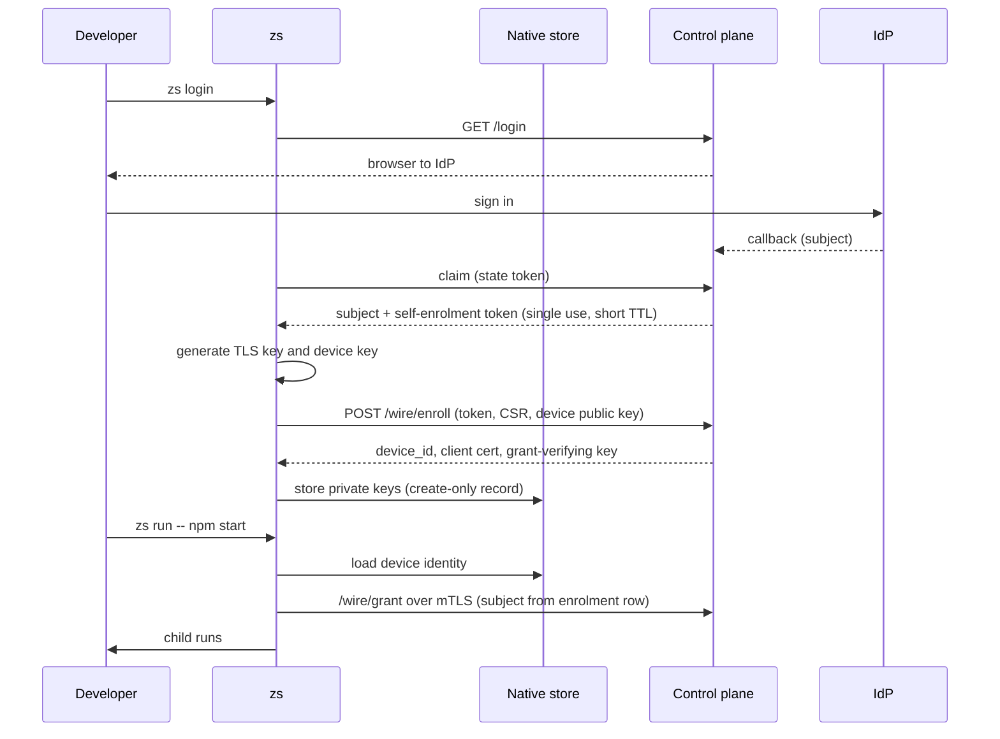

# Plain `zs run` in an app repository

**2026-10-16 · Draft for owner review**

Amended 2026-10-29 on the owner's instruction: customer names, customer infrastructure identifiers and references to unpublished files replaced; the design is unchanged.

## 1. Intent

A developer who has an app checked out (acme, globex) signs in once and then runs the app
the way they always do, behind ZeroSecret:

```bash
zs login               # once per laptop: SSO in the browser
zs run -- npm start    # every time: no flags, no token, no wrapper script
```

Today that does not work. `zs run` against a control plane needs a new one-time
`--enrollment-token` on every run (ADR-0015), and `--control`, `--ca-dir` (holding
`control-ca.crt`), `--credentials-dir` and `--policy` have no home other than the command line.
The acme and globex harness branches work around this with `zerosecret/zs-dev.sh`, which mints a
token per run through the dashboard. That proves the data plane, not the developer experience.

**Why now.** The goal in the project state file (not published) is a seamless, tested integration. Acme and globex
already pass every E2E scenario; the remaining gap is the command a developer types.

## 2. Goals, non-goals, anti-goals

**Goals**

1. `zs login` followed by `zs run -- <cmd>` works in the acme root with no flags.
2. One sign-in per laptop. Later runs reuse the device enrolment until it is revoked or expires.
3. The subject on a grant is the subject that signed in through SSO, proven by the control plane,
   not claimed by the agent.
4. Every failure (no sign-in, revoked device, locked keychain, unreachable control plane) stops
   `zs run` before the child starts, with one line that says what to do.

**Non-goals**

- Where secret values live. They stay in the `--credentials-dir` file store (owner decision
  2026-10-16: "use the existing acme repo"; acme's secrets were moved there by a one-time
  script). Vault integration and a `zs import` command are separate work.
- Fleet features: device posture, attestation, approval of self-enrolment.
- Globex. It follows the same path; its `zs-policy.json` is written after acme passes.

**Anti-goals** (failure even if it technically works)

- A device private key, TLS key or session secret in a plain file.
- Any path where an unverified subject reaches a grant.
- A run that starts the child after an identity or trust failure.

## 3. Already done during exploration (working tree, not committed)

The owner asked to make plain `zs run` work in acme and to fix issues on the way
(2026-10-16). Done and tested:

| Change | Why | Evidence |
|---|---|---|
| `listen_port` on mysql, postgres and mongo bindings (`ResourceBinding::listen_addr`) | `npm start` bakes `.env` into the bundle (`DotenvWebpack` replaces `process.env` with `{}` plus the file's values), so acme needs fixed listener addresses in `.env` | `mysql_l3.rs`: config load, bind on the port, refuse a taken port (child does not start) |
| `zs run` creates a missing audit directory (0700) | The default `.zs-audit/audit.jsonl` failed on a fresh checkout | `startup_lifecycle.rs::an_absent_audit_directory_is_created_private` |
| `fail_closed_matrix.rs` row 13 asserts the fixed text | Stale since `7fa22121` (ADR-0032 keeps the method out of `reason`) | `cargo test -p zs`: 235 passed, 0 failed |

Acme (test bed): `.env` backed up to `~/.zs-backups/acme/` (0600), the six brokered secrets moved
to `~/.zs-credentials/acme/`, `.env` rewritten without them and with the database hosts on
`127.0.0.1:13306/13307/27117`, `zs-policy.json` added. `zs run --control … --enrollment-token …
--credentials-dir … --ca-dir … -- npm start` from the acme root: healthy in 26 s, auth POST 200
(`allow POST`), MySQL route 200, MySQL/replica/Mongo `upstream_auth_ok`, no secret value in
acme's environment, `.env`, `dist/server/index.js`, audit or diagnostic log; Ctrl-C leaves no
process and closes the listeners.

## 4. Owner decisions (2026-10-16)

1. **Enrolment: both.** SSO sign-in replaces the operator token, and the device keys are kept in
   the native secure store so later runs reuse the enrolment.
2. **Run settings live in `zs-policy.json`.** CLI flags still override.

## 5. Design



### 5.1 Run settings in `zs-policy.json`

A new optional top-level object:

```json
{
  "run": {
    "control": "http://127.0.0.1:8443",
    "control_ca": "zerosecret/control-ca.crt",
    "credentials_dir": "~/.zs-credentials/acme"
  },
  "bindings": [ ... ]
}
```

- `control`, `control_ca`, `credentials_dir`, `ca_dir`, `audit` are the keys. Unknown keys are
  refused (`deny_unknown_fields`, like bindings).
- A command-line flag wins over the file. A key absent from both keeps today's default.
- `~/` expands to `$HOME`. A relative path resolves against the directory that holds the policy
  file, so `zs run --policy ../zs-policy.json` means the same thing as running from that
  directory. (My call.)
- `zs login` reads `run.control` from `./zs-policy.json` when `--control` is absent, and prints the
  URL before it opens the browser.
- **Committed settings are steerable by the repository (my call).** `zs run` uses a stored
  enrolment only for the exact control URL that `zs login` enrolled with, so a repository that
  names another control plane gets `not enrolled`. `credentials_dir` from the file must resolve
  under `~/.zs-credentials/`; a flag may name any directory. Host steering is closed by §5.4a.

### 5.2 Control-plane trust anchor

`run.control_ca` names a PEM file with the control plane's CA certificate. It is public and is
committed with the app. It replaces `<ca-dir>/control-ca.crt`; when both exist and differ,
`zs run` refuses. `zs login` and `zs run` never fetch the CA from the control plane they are about
to trust. (My call: the alternative, trust on first use of `GET /ca`, lets a network attacker
choose the anchor.)

**Transport for sign-in and enrolment (my call).** `/login`, `/login/claim` and `/wire/enroll`
are on the plain-HTTP router today, and the claim response will carry a bearer token. `zs login`
accepts an `http://` control URL only when its host is a loopback address; any other host must be
`https://` and is verified against `run.control_ca`. A TLS listener for the dashboard router is
out of scope; a non-loopback deployment puts a TLS terminator in front, and its certificate chain
must be in `control_ca`.

### 5.3 SSO self-enrolment

- The control plane mints a **self-enrolment token** when an OIDC login completes and the
  `/login/claim` call for it arrives. The token is bound to the signed-in subject and to the
  organization from the subject's `members` row, single use, TTL 5 minutes, stored as a SHA-256
  digest like operator tokens. `/login/claim` returns it beside `subject`.
- A subject with no `members` row gets no token: `zs login` fails with
  `not a member of any organization; ask an admin to add <subject>`. (My call: membership is
  the admin's control point that replaces handing out tokens.)
- **Claim binding (my call).** `zs login` makes a random 32-byte verifier and sends its SHA-256 with
  `GET /login?cli_challenge=…`. The control plane stores the challenge on the `pending_logins` row.
  `/login/claim` needs the verifier and returns the self-enrolment token only when it matches. A
  login started without a challenge (the dashboard) is never claimable for a token.
- **Phishing check (my call).** `zs login` prints a 6-character code derived from the challenge.
  The callback page shows the same code and the device name and asks the user to compare before
  closing the tab. This does not stop a user who ignores it; it is recorded in SECURITY §3.
- **Organization and project (my call).** Self-enrolment needs exactly one `members` row for the
  subject. With none: `not a member of any organization; ask an admin to add <subject>`. With more
  than one: refuse with `member of several organizations; use an enrolment token`. The device gets
  no project, so it reaches only unprojected resources (ADR-0021).
- `zs login` then enrols at once through the existing `/wire/enroll`, so the 5-minute TTL is
  never in the way.
- The enrolment row records the subject. **Operator tokens (my call):** a token issued in the
  dashboard is bound to the issuing operator's own subject; there is no free subject field,
  because any signed-in dashboard user can issue tokens today (`authorize_form` checks only the
  session and CSRF). The harnesses sign in to the dashboard and to `zs login` as the same subject,
  so they keep working.
- ADR-0015 changes: SSO sign-in plus membership becomes an accepted alternative to the operator
  token. A new ADR records this and what replaces the "human step".

### 5.4 The subject on a grant comes from the enrolment row

Finding (2026-10-16): `/wire/grant` takes `subject` from the request body
(`apps/control/src/wire.rs`, `wire_grant`). The device signs the body, but the device chooses the
subject, so any enrolled device can request grants as any member.

- For a device whose row has a subject, `/wire/grant` refuses a body whose `subject` differs
  (401 with the device-level code from §5.6).
- **Membership at grant time (my call).** `/wire/grant` also refuses when the device's subject has
  no `members` row in the device's organization any more. Removing a member therefore stops their
  devices at the next grant (grants live at most 300 s).
- For a device with no subject (enrolled before this change), see Q1.

### 5.4a The signed grant names the host (my call)

`zs_grant::Grant` names the resource but not its host, so the binding in `zs-policy.json` decides
where a granted credential goes. Once that file is committed in the app repository, a pull request
could point `acme-auth` at another host and receive the credential. The grant gains `host` and
`protocol`, filled by the control plane from its resource row; the agent refuses a binding whose
`host` or `protocol` differs from its grant (`zs: <resource>: binding host does not match the
grant`). A grant without `host` (minted before the change) is refused. This changes the signed
format; it needs its own ADR.

### 5.5 Persisted device identity

- **Private:** the TLS client key and the device signing key, in one native record per
  enrolment, through the same engine that holds the local CA key (Keychain on macOS, Secret
  Service on Linux, Credential Manager on Windows; create-only write, exact-record delete,
  bounded `security` calls). The engine is generalized out of `zs-mitm/src/ca/platform` so the
  CA and the device share it; the CA's behavior and its tests do not change.
- **Public:** `device_id`, client certificate, grant-verifying key and key id (ADR-0016),
  control URL and the SHA-256 of the control CA, in `$ZS_HOME/.zs-device.json` (0600), beside
  `.zs-session`.
- **Control-plane signing key (my call).** `control` generates its grant-signing key on every start
  (`apps/control/src/main.rs`), which would break every stored enrolment after a restart (ADR-0016
  pins the key at enrolment). The key is persisted in `ZS_CONTROL_CA_DIR` beside the control CA key,
  which is already kept there, with the same file mode. `zs run` that sees a grant whose key id it
  pinned but whose signature does not verify refuses with `zs: control plane signing key changed;
  run zs login`.
- One enrolment per `(ZS_HOME, control URL)`. A second `zs login` against the same control plane
  replaces it: enrol the new device first, then delete the old exact record.

### 5.6 `zs run` with a stored enrolment

- With `run.control` (or `--control`) and no `--enrollment-token`, `zs run` loads the stored
  enrolment for that control URL.
- `--enrollment-token` keeps today's behavior: a fresh, unsaved enrolment (the harnesses use it).
- Refusals, each before the child starts, exit 1:

| Condition | Line |
|---|---|
| No stored enrolment for this control URL | `zs: not enrolled with <url>; run zs login` |
| Stored control CA hash differs from `run.control_ca` | `zs: control plane CA changed; run zs login` |
| Native store locked or unreadable | existing `zs: local ca:`-style line for the device record |
| Control plane refuses the device itself (deleted, subject mismatch, member removed, enrolment expired) | `zs: this device is no longer enrolled; run zs login` |
| Grant signature fails for the pinned key id | `zs: control plane signing key changed; run zs login` |

**Device-level versus policy refusals (my call).** `/wire/grant` answers device-level refusals with
401 and a JSON `code` (`device_unknown`, `subject_mismatch`, `not_a_member`, `enrolment_expired`);
only these stop the run. A policy denial for one binding stays a 403 and keeps today's behavior: the
run starts, the binding has no grant, and its requests are denied and audited.

### 5.7 `zs logout`

Removes `.zs-session`, `.zs-device.json` and the exact native record. It does not call the
control plane (my call; revocation stays an admin action in the dashboard).

### 5.8 Acme

`zs-policy.json` gets the `run` block; `zerosecret/control-ca.crt` is committed with it;
`.gitignore` gains `.zs-audit/`, `.zs-log/` and `.zs-ca/`. `zs-dev.sh` stays for globex until
globex moves.

## 6. Done when

1. Acme, from its root, on a laptop with no `$ZS_HOME/.zs-device.json`:
   `zs login` (headless Keycloak sign-in in the test) then `zs run -- npm start` with no flags:
   healthy, auth POST 200 with `allow POST`, MySQL route 200, all three databases
   `upstream_auth_ok`, no secret value in acme's environment, `.env`, bundle, audit or
   diagnostic log.
2. A second `zs run -- npm start` reuses the enrolment: no new row in `devices`.
3. Negative controls, each with the child not started: device deleted in the dashboard; a body
   subject that differs from the enrolment subject (control-plane test); a subject that is not a
   member; a mismatched `control_ca`; a binding whose host differs from its grant; a claim without
   the verifier; a control-plane restart (enrolment keeps working, since the signing key persists).
4. The acme and globex E2E harnesses still pass (`--enrollment-token` path).
5. CI green, including `macos-native` for the new native record.

## 7. Left to the builder

- The shape of the generalized native-store API and where it lives (new crate or a module of an
  existing one), as long as the CA's tests stay unchanged.
- Schema migration details for the subject columns.
- Exact wording of new error lines beyond the table in §5.6.
- Whether `zs status` shows the stored enrolment (recommended).

## 8. Owner answers (2026-10-16)

- **Q1. Devices with no subject: refuse them.** `/wire/grant` answers 401 `device_unknown` for a
  device row without a subject. Every developer runs `zs login` once; the harnesses enrol per run.
- **Q2. Enrolment lifetime: 7 days** after `zs login` (`enrolment_expired`), on top of the
  membership check in §5.4.

## 9. Builder check (2026-10-16)

A fresh builder read this document and the code. Its questions and where they went:

| Question | Resolution |
|---|---|
| Control signing key regenerated per start | §5.5, my call |
| Login and enrol over plain HTTP | §5.2, my call |
| Claim tied to the CLI; phishing | §5.3, my call |
| Devices with no subject | Q1 |
| Who may bind a subject on an operator token | §5.3, my call |
| What ends an enrolment | §5.4 membership (my call) and Q2 |
| Which grant failures stop the run | §5.6, my call |
| Organization and project of a self-enrolment | §5.3, my call |
| Committed settings steering the run | §5.1 and §5.4a, my call |
