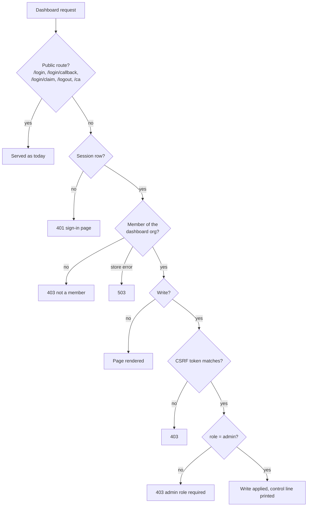

# Dashboard write roles (O6)

**2026-10-23 · Approved by the owner 2026-10-23** · new ADR-0042 (ADR-0039, ADR-0040 and ADR-0041 are reserved
by the hyper, Cedar and AWS SSM work) · prerequisite of the AWS SSM spec (not published)
· closes the limit "A connection value is as strong as dashboard write access" (SECURITY §3,
`docs/SECURITY.md:163-171`)

Amended 2026-10-29 on the owner's instruction: customer names, customer infrastructure identifiers and references to unpublished files replaced; the design is unchanged.

## 1. Intent

The dashboard is where an admin sets what the control plane signs: a resource's host and
connection (ADR-0038), its grant rules, and soon its AWS SSM role and parameter. Today anyone the
IdP verifies can change all of it. The recon on 2026-10-23 found:

| Gap | Where |
|---|---|
| Every write checks only a session and a CSRF token. No code reads `members.role` | `authorize_form`, `apps/control/src/session.rs:622-646` |
| A session is created for any verified identity, member or not | `apps/control/src/session.rs:365-372` |
| Every dashboard page and write acts on the `default` org, with no membership check | `default_organization()`, `apps/control/src/state.rs:414-418`; `apps/control/src/dashboard.rs:653` |
| `POST /approvals/{id}/approve` has no session or CSRF check at all | `apps/control/src/dashboard.rs:1702` |
| `POST /enrollment-token` takes the org from the form | `apps/control/src/dashboard.rs:1204-1239` |
| All dashboard GET pages, `/audit` and `/export/audit` (up to 10,000 rows) need no session | `apps/control/src/dashboard.rs:12, 171, 335, 536, 611, 1249, 1379, 1592` |
| `GET /approvals` lists every org's approvals | `apps/control/src/dashboard.rs:1694`, `Store::approvals` |
| There is no first admin: members are added only through `/members/create` | `apps/control/src/main.rs:25-61` |

After this change, only a member with the role `admin` in the dashboard's org can change
anything. A `member` signs in, runs `zs`, reads the dashboard, and issues enrolment tokens for
their own devices. Anyone else reads nothing. The
first admins come from an environment variable on the control host.

## 2. Goals, non-goals, anti-goals

**Goals**

1. Every dashboard write needs a session, a matching CSRF token, and the role `admin` in the
   dashboard's org (owner, 2026-10-23: "any team member who [has a] specific role assigned can
   change resource"). The one exception is an enrolment token for the issuer's own device (§4.5).
2. Two roles only, `admin` and `member` (owner, 2026-10-23).
3. Every dashboard read needs a session whose subject is a member of the dashboard's org, with
   either role. This includes audit and the audit export (owner, 2026-10-23).
4. The first admins are set by `ZS_CONTROL_ADMINS` on the control host (owner, 2026-10-23).
5. The acme and globex E2E harnesses keep working, after a change on their side.

**Non-goals (v1)**

- A third role (owner), per-project roles, or IdP group-to-role mapping. Compared with Bitbucket
  (owner question, 2026-10-23), v1 is the workspace level only: workspace admin and member. A
  project admin is the natural next step; the `projects` table and the resource and device
  project fields already exist. A per-resource "write" role is not planned: who may use a
  credential is decided by the signed grant rules, never by a dashboard role.
- A dashboard for several orgs (an org picker, or binding a session to an org row).
- API tokens for automation. Harnesses keep driving the dashboard forms.
- The `ZS_CONTROL_ORG` mismatch: `main.rs` seeds the policy for `ZS_CONTROL_ORG`, but the
  dashboard always acts on `default`. This spec does not change which org the dashboard acts
  on (see §4.1); the mismatch becomes an open item.
- Any change to `/wire/*`. The role does not change what a device may be granted. Members and
  admins enrol and get grants by the same grant rules.
- Putting dashboard changes into the hash-chained audit journal. They stay `control:` lines.

**Anti-goals** (the change fails even if it works)

- A non-admin changes anything by any path: a hidden form, a hand-written `curl` POST, a missing
  or stale CSRF token, a route that skips the check.
- A role change takes effect only after the session ends, or after a restart.
- A store error or an unknown role value lets a request through.
- The dashboard can be left with no admin and no way back except editing the database.
- A dashboard page shows data from an org the subject is not a member of.

## 3. Decisions

| # | Decision | By |
|---|---|---|
| D1 | Roles are `admin` and `member`. An admin does every dashboard write; a member reads | owner 2026-10-23 |
| D2 | First admins come from `ZS_CONTROL_ADMINS` at startup | owner 2026-10-23 |
| D3 | Any member reads every dashboard page, including audit and its export | owner 2026-10-23 |
| D4 | The role is read from `members` on every request. Nothing caches it, so a demotion or removal applies to the next request | writer |
| D5 | The org a dashboard request acts on stays `default_organization()`. `ZS_CONTROL_ADMINS` makes admins in that org | writer |
| D6 | `ZS_CONTROL_ADMINS` only adds: removing a subject from the variable unpins it, but its row stays `admin` until an admin changes it | writer |
| D7 | Subjects listed in `ZS_CONTROL_ADMINS` are pinned: the dashboard refuses to demote or remove them | writer |
| D8 | The dashboard refuses a demotion or removal that would leave the org with no admin | writer |
| D9 | Any member of org X, admin or not, may issue an enrolment token for X. The token stays bound to the issuer's own subject (ADR-0036), like a Bitbucket personal token, so it gives no more than `zs login` does. A subject who is not a member of X is refused | owner 2026-10-23 |
| D10 | Approvals become org-scoped: `pending_approvals` gains `organization_id`, `/wire/grant` writes the device's org, the list shows only the dashboard org, and approve is an admin write with CSRF | writer |
| D11 | A role value other than `admin` or `member` is refused on write, and refused by a database constraint. Existing free-text values other than `admin` become `member` | writer |
| D12 | Members see the same pages without the forms. Forms and CSRF tokens are rendered only for admins, except the enrolment token form, which every member sees | writer |
| D13 | One subject rule for `ZS_CONTROL_ADMINS` and the member forms: not empty after trimming, no control characters, no comma, at most 320 bytes; matched exactly, case included, against the session subject (`email` claim, else `sub`, `apps/control/src/oidc.rs:169`) | writer (builder check) |
| D14 | D7 and D8 apply to every path that can change or drop a role: `/members/create` (an upsert, `apps/control/src/store.rs:658-661`), `/members/update` (a rename deletes the old row, `:710-736`) and `/members/delete`. `role=admin` for a pinned subject is accepted | writer (builder check) |
| D15 | The 403 `not a member` page carries the enrolment token form, limited to the subject's own orgs, so a subject outside the dashboard org can still issue their own token (§4.5) | writer |

## 4. Design

### 4.1 The dashboard org

The dashboard acts on one org, `default_organization()`, as it does today (D5). Every check below
is a membership or role check in that org. A subject who is a member only of another org gets
403 on every dashboard page. Their `zs login` and `/wire/*` paths are unchanged.

### 4.2 Roles in the store

- `members.role` holds `admin` or `member`. A schema change maps every existing value other than
  `admin` to `member`, then adds `CHECK (role IN ('admin', 'member'))` (D11).
- One store call returns the subject's role in an org, or none. Authorization uses only this call.
- `/members/create` and `/members/update` accept `role` = `admin` or `member`. A blank role stays
  `member`, as today. Any other value is 400 `role must be admin or member`.
- Both forms apply the D13 subject rule. Today `create_member` stores an empty subject
  (`apps/control/src/dashboard.rs:1054-1056`); after this change it is 400.

### 4.3 First admins: `ZS_CONTROL_ADMINS`

- A comma-separated list of subjects. Spaces around a subject are dropped. An item that breaks
  the D13 rule stops `control` at startup with exit 1 and
  `control: ZS_CONTROL_ADMINS: item <n>: <reason>`. The line names the item by position and never
  repeats its value.
- At startup, after the policy seed, `control` upserts each listed subject as `admin` in the
  dashboard org and prints `control: dashboard admins from ZS_CONTROL_ADMINS: <count>`.
- Unset or empty, nothing is added. If the org then has no admin, `control` still starts and
  prints `control: no dashboard admin in <org>; set ZS_CONTROL_ADMINS`. The wire side works
  without an admin.
- Pinned (D7, D14): any write that would make a listed subject `member` or drop its row
  (`/members/create`, `/members/update` including a rename, `/members/delete`) is 400
  `<subject> is set by ZS_CONTROL_ADMINS on the control host`. Pins come from the value read at
  this start; the store does not record them.
- Recovery when every admin is lost: set the variable and restart. No other path exists.

### 4.4 The checks

One function decides each dashboard request. `authorize_form` becomes the write check; a new read
check guards the GET handlers. Both read the session subject, then the role (D4).

| Request | No session | Not a member | Member | Admin | Store error |
|---|---|---|---|---|---|
| GET `/`, `/resources`, `/grants`, `/members`, `/projects`, `/devices`, `/audit` | 401 sign-in page | 403 page `<subject> is not a member of <org>` | 200, no forms | 200, forms | 503 |
| GET `/export/audit`, `/approvals` | 401 | 403 | 200 | 200 | 503 |
| Every dashboard POST (§1 list, plus approve), except `/enrollment-token` | 401 | 403 | 403 `admin role required` | applied if CSRF matches, else 403 | 503 |
| POST `/enrollment-token` for org X | 401 | 403 when not a member of X | applied if CSRF matches, else 403 | applied if CSRF matches, else 403 | 503 |

- Public, unchanged: `/login`, `/login/callback`, `/login/claim`, `/logout`, `/ca`, `/wire/*`.
- A session is still created for any verified identity, so the 403 page can name the subject.
  `zs login` does not use the session: the CLI claims its result through `POST /login/claim`.
- Check order on a write: session, membership, CSRF, role. A failure at any step denies. No
  write handler runs before the check returns `Operator`.
- `POST /approvals/{id}/approve` moves from a path-only POST to the same form shape as the other
  writes (`csrf_token` field). Its handler checks that the approval's `organization_id` is the
  dashboard org; another org's id is 404.
- A refused write prints `control: dashboard write refused for <subject>: <reason>`. A role
  change prints `control: member role changed by <admin> subject=<subject> role=<role>`.

### 4.5 Enrolment tokens

`POST /enrollment-token` needs a session and a matching CSRF token. The org is the form's
`organization`, or the dashboard org when it is omitted. The session subject must be a member of
that org, with either role; otherwise the answer is 403
`<subject> is not a member of <org>` and no token is issued (D9). The token stays bound to the
issuer's own subject (ADR-0036 "Operator tokens"). This keeps the path that README.md:87 gives a
subject in several orgs, whom `zs login` refuses with `several_organizations`, and closes the
cross-org write: today any session can mint a token for any org.

The form lives on `/devices` today, which a subject outside the dashboard org cannot open, so they
would get no CSRF token (writer's call, D15). The 403 `not a member` page therefore shows, for a
subject who is a member of at least one org, only the enrolment token form: a CSRF token and a
choice of that subject's own orgs. It shows no other org data. A member of the dashboard org uses
the form on `/devices`, which can name any of their orgs.

### 4.6 Approvals

`pending_approvals` gains `organization_id`. `/wire/grant` writes `standing.organization` when it
records an approval. Rows without an org are deleted by the schema change. No grant path reads
the `approved` flag; only `GET /approvals` lists it, so deleted rows leave that list and nothing
else changes. `Store::approvals` takes the org.

## 5. Fail-closed rows

New SECURITY §7 rows. Each has a named test in `apps/control/tests/`.

| Condition | Result |
|---|---|
| Dashboard POST with a session whose subject is a `member` | 403, nothing written |
| Dashboard POST with a session whose subject is not a member of the dashboard org | 403, nothing written |
| Dashboard GET with no session, including `/audit` and `/export/audit` | 401, no org data in the body |
| Membership or role lookup fails | 503, nothing written or shown |
| `POST /approvals/{id}/approve` with no session or no CSRF token | 401 or 403, flag unchanged |
| Admin demoted while signed in; next POST from that session | 403 |
| Demotion or removal of the last admin, by create, update, rename or delete | 400, row unchanged |
| Demotion or removal of a `ZS_CONTROL_ADMINS` subject, by create, update, rename or delete | 400, row unchanged |
| `ZS_CONTROL_ADMINS` with an empty item or an invalid subject | `control` exits 1 before it listens |
| `/members/create` or `/members/update` with a role outside `admin`, `member` | 400, row unchanged |
| `/enrollment-token` naming an org the subject is not a member of | 403, no token |

## 6. Tests the plan must include

- Each row in §5 starts with its positive control: the same request as an admin succeeds, then
  the denied variant runs (AGENTS.md verification reminders).
- One test walks every dashboard route in the router and asserts it is public by the §4.4 list,
  or that it denies an anonymous request. A new route that skips the checks fails this test.
- The schema change maps `owner`, `Admin`, `''` and `member` rows: only `admin` stays admin.
- Existing control tests that change:
  - writes as the non-member `operator@company.com` (`apps/control/tests/dashboard_crud.rs:18-28`,
    `apps/control/tests/enrollment_token_endpoint.rs:16-26`) make their subject an admin first;
  - reads with no session (`apps/control/tests/audit_export.rs:23-31` for `/export/audit` and
    `/audit`, `apps/control/tests/control_test.rs:491, 529`) sign in a member first;
  - `apps/control/tests/enrollment_token_endpoint.rs:130-154` (a token for `acme`) makes its
    subject a member of `acme` first, and gains the refusal case for a non-member.
- E2E: acme and globex harness runs exit 0 on the new control (§7).

## 7. Harnesses (acme, globex)

Both sign in to the dashboard as `dev@zerosecret.local` and then add that subject with
`role=member` (`lib/idp.sh:50`, `lib/dev-stack.sh:142`) before they create resources and grants.
Under D7 that POST would be refused.

- Their dev stack starts `control` with `ZS_CONTROL_ADMINS=dev@zerosecret.local`.
- The self-add step is dropped, or sends `role=admin`, which is accepted for a pinned admin.
  Builder's call.
- A harness that also needs a plain member (for a "member cannot write" check) adds a second
  subject through `/members/create`.

Acme and globex are test targets; their commit state is not tracked here.

## 8. Docs

- ADR-0042: roles, the env bootstrap, D4-D12.
- SECURITY §3: the paragraph at `docs/SECURITY.md:163-171` changes to "A connection value is as
  strong as the dashboard admin role". The list of what a connection change can do stays.
- SECURITY §1 trust table: the dashboard row says reads need membership and writes need `admin`.
- SECURITY §7: the §5 rows.
- ADR-0038 "Admin" ruling (`docs/DECISIONS.md:161-162`) now means the `admin` role; ADR-0038
  gets no edit, ADR-0042 says it replaces that ruling.
- README / operator docs: `ZS_CONTROL_ADMINS`.
- Open item for the `ZS_CONTROL_ORG` mismatch.

## 9. Left to the builder

- How the read check is wired (an axum extractor, a middleware on the dashboard router, or a
  call in each handler), provided the §6 route test passes.
- How the schema change is written, given the single `0001_initial.sql` file.
- The exact HTML of the 401 and 403 pages.
- Whether the harness self-add is dropped or sends `role=admin` (§7).
