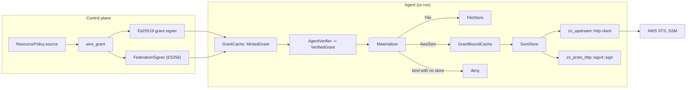
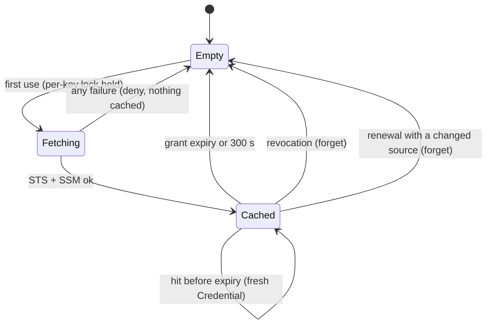

# Credential sources as a general interface, with AWS SSM as the first remote store

**2026-10-24 · Tier 3 design review · Accepted by the owner 2026-10-24** · extends
the AWS SSM spec (not published) (the SSM spec) and
replaces the parts listed in §13 · new ADR-0043 (typed credential source) and ADR-0044 (audit
credential reference) · ADR-0041 still records the SSM value-cache exception · evidence:
the AWS SSM spike notes (not published) and three read-only architecture
surveys run on 2026-10-24

Amended 2026-10-29 on the owner's instruction: customer names, customer infrastructure identifiers and references to unpublished files replaced; the design is unchanged.

## 1. Problem and context

The SSM spec adds AWS SSM as a special case. It adds an optional `aws_ssm` block to
`ResourcePolicy` and to `Grant`, and a second store next to `FileStore`. A later store (Vault,
GCP Secret Manager, Azure Key Vault) would add one more optional block in both places, one more
branch, one more HTTP client and one more cache.

The owner decided on 2026-10-24 to make the store layer a general interface, with SSM as the
first remote store on it. The owner also asked for a review of other parts of the architecture
where a general interface makes extension easier.

The code today:

- `Materializer` holds exactly one `CredentialStore` and one `ExchangeProvider`
  (`crates/zs-materializer/src/lib.rs:170-193`). Production wires `FileStore` and
  `UnconfiguredExchange`, which always errors (`apps/zs/src/run.rs:12-24`, `:709-714`).
- `CredentialStore::retrieve(&CredentialRef)` is synchronous and sees only the reference
  (`lib.rs:20-22`). SSM also needs the signed `aws_ssm` fields and the identity token.
- The signed grant names its credential as one free string, `credential_ref`
  (`crates/zs-grant/src/lib.rs:33-72`).
- `VaultKvV2`, `TokenEndpointExchange` and the free function `materialize` have no production
  caller.
- There is no shared outbound HTTP client. Six `reqwest` builders each pick their own proxy,
  timeout and redirect settings (§5.4).

The review also found defects in existing code. §10 lists them; Phase A fixes them first.

## 2. Proposed design

### 2.1 Overview



The design has five parts:

1. A typed, signed `CredentialSource` on the grant replaces the free `credential_ref` string.
2. An async `CredentialStore` trait takes a `RetrieveContext`. A closed `StoreRegistry` routes
   by source kind and never falls back.
3. One hardened outbound HTTP client builder in `zs-upstream`.
4. One shared SigV4 `sign` function in `zs-proto-http`.
5. One `GrantBoundCache` wrapper for remote stores, and one `FederationSigner` that takes
   `aud` and `sub` as inputs.

### 2.2 Typed credential source (ADR-0043)

A new module `crates/zs-policy/src/source.rs`, in the same crate as `Connection` and
`UpstreamTlsMode`, which `Grant` already imports:

```rust
#[serde(tag = "kind", rename_all = "snake_case", deny_unknown_fields)]
pub enum CredentialSource {
    File { reference: String },
    AwsSsm(AwsSsmSource),
}
pub struct AwsSsmSource { pub role_arn: RoleArn, pub region: AwsRegion, pub parameter: SsmParameter }

impl CredentialSource {
    pub fn kind(&self) -> SourceKind;
    pub fn mode(&self) -> Materialization;          // AwsSsm -> Retrieve
    pub fn identity_audience(&self) -> Option<&str>; // AwsSsm -> "sts.amazonaws.com"
    pub fn validate(&self) -> Result<(), SourceError>;
}
```

`RoleArn`, `AwsRegion` and `SsmParameter` are validating newtypes. `SsmParameter` refuses a
name whose session policy is longer than 2048 characters (§13, item 5).

**Grant JSON.** `Grant` gets `source: CredentialSource` through
`#[serde(try_from = "GrantWire", into = "GrantWire")]`:

- A `File` source serializes as the existing `"credential_ref"` key. Local-mode file grants and
  grants already in flight keep parsing.
- A remote source serializes as `"source"`.
- A grant with both keys, or neither, is refused.
- An agent from before this change cannot parse a grant without `credential_ref`, so it denies.
  This is fail-closed by construction, and a test pins it.

**Canonical signed payload.** Records are `key␟value␞`, in alphabetical key order
(`zs-grant/src/lib.rs:33-72`).

- A `File` grant signs exactly the bytes it signs today. A golden byte-vector test is added in
  Phase A, before any refactor, to prove this.
- An `AwsSsm` grant drops `credential_ref` and adds four records between `resource` and
  `subject`, which keeps the order alphabetical:

```text
source.kind␟aws_ssm␞source.parameter␟/acme/prod/DB_PASSWORD␞source.region␟ap-southeast-1␞source.role_arn␟arn:aws:iam::123456789012:role/zs-acme-db␞
```

**Mode stays signed.** `materialization` stays in the payload (ARCHITECTURE §6). The control
plane refuses a resource where `materialization != source.mode()`, and the agent denies the
same mismatch. SSM can never be labelled `exchange`.

**Policy and dashboard.**

- `ResourcePolicy` gets `source: Option<CredentialSource>`. A document without it reads
  `credential_ref` as `File`. A document with both is refused.
- `ResourcePolicy::resolved_source()` replaces the `vault:kv/<resource>` default at
  `apps/control/src/wire.rs:350-354`. The default keeps its exact bytes so existing setups
  keep working.
- One `validate` call runs on create, update, seed and `wire_grant`, the same pattern as
  ADR-0038 C7.
- The agent's `zs-policy.json` (`AgentFile`) refuses any source that is not `File`. A local
  file cannot redirect the agent to a role, a region or a parameter (SSM spec §2 anti-goal).
- The dashboard gets one shared form-block helper, used by the connection block
  (`dashboard.rs:82-188`) and the new source block. The source block has a `source_kind`
  select and writes a `resource source changed` line.

**Exchange stays separate.** No exchange implementation is wired in production. A temporary
role is a lease with a release step, which does not fit `-> Credential`. `SourceKind` is the
routing key, so a later exchange kind can be added there.

### 2.3 Store trait and registry

In `zs-materializer`:

```rust
pub struct RetrieveContext<'a> {
    pub grant: &'a VerifiedGrant,
    pub identity_token: Option<&'a IdentityToken>,
    pub now_ms: u64,
}

#[async_trait]
pub trait CredentialStore: Send + Sync {
    fn kind(&self) -> SourceKind;
    async fn retrieve(&self, cx: &RetrieveContext<'_>) -> Result<Credential, MaterializationError>;
    fn forget(&self, _resource: &str) {}
}

pub struct StoreRegistry {
    file: Arc<dyn CredentialStore>,
    aws_ssm: Option<Arc<dyn CredentialStore>>,
}
```

- **Closed struct, exhaustive `match`.** There is no string-keyed map and no plugin system
  (ROADMAP "Deliberately unscheduled"). A kind with no store denies with `NoStore { kind }`.
  Nothing falls back to `FileStore` (SECURITY §7).
- **`VerifiedGrant`.** `AgentVerifier::verify` returns `VerifiedGrant` instead of `()`
  (`zs-grant/src/lib.rs:169-217`). Only a `VerifiedGrant` can build a `RetrieveContext`, so the
  type system blocks a store from seeing an unverified grant.
- **Small migration.** The only production caller of `retrieve` is
  `Materializer::materialize`, which is already async. Its one production caller is
  `apps/zs/src/lib.rs:1063`. `FlowHandler::materialize` stays synchronous; making it async is
  hyper plan Task 4a (§8).
- **Typed errors.** `MaterializationError::Denied(String)` becomes typed variants:
  `NoStore`, `NoIdentityToken`, `Refused { kind, step, code }`, `Transport { kind, step,
  TransportKind }`, `SessionExpired` and `InvalidValue`. `code` is an allow-listed AWS error
  code, never free text. `SessionExpired` is an internal retry signal and replaces the spike's
  match on error text.
- **Postgres sees the reason.** `zs-proto-postgres` writes `denied.reason` to the psql client
  (`crates/zs-proto-postgres/src/lib.rs:1650`). The reason shown to the workload is therefore a
  fixed phrase per variant. The parameter name and role ARN go only to the audit record and
  the diagnostic event.

### 2.4 Shared hardened outbound client

A new module `zs_upstream::http`, behind a non-test Cargo feature `reqwest`. ADR-0030 already
makes `zs-upstream` the shared outbound crate, and ADR-0013 asks for one TLS configuration to
audit.

```rust
pub enum ProxyPolicy { None, System }
pub fn client(roots: Roots, timeout: Duration, identity: Option<Identity>, https_only: bool,
              proxy: ProxyPolicy, network: &Network) -> Result<reqwest::Client, ClientError>;
pub fn transport_kind(e: &reqwest::Error) -> TransportKind; // TimedOut | Unreachable | Tls | Other
pub struct Network { resolve: Vec<(String, SocketAddr)>, extra_roots: Vec<CertificateDer> }
```

- The builder always sets `redirect::Policy::none()` and rustls on ring. Callers choose the
  timeout. Proxy use is a `ProxyPolicy` parameter: store clients always pass `None`, and
  control-plane clients pass `System` (Q1, §12).
- `transport_kind` walks `source()`, so a TLS failure no longer reads as "unreachable"
  (spike finding 6). The URL never enters error text.
- `https_only` is a parameter, because `wire_url_allowed` allows plain http to loopback
  (`apps/zs/src/lib.rs:501`).
- `Network::default()` is empty. §2.7 describes how tests fill it.

The SSM store, and every future remote store, must use this builder. The enrol, mTLS wire,
login and OIDC clients move onto it with `ProxyPolicy::System` (Q1, §12).

### 2.5 Shared SigV4 signing

A new public module `crates/zs-proto-http/src/sigv4.rs`:

```rust
pub struct Scope<'a> { pub access_key_id: &'a str, pub region: &'a str, pub service: &'a str }
pub enum Query<'a> { Raw(&'a str), Pairs(Vec<(String, String)>) }
pub struct Request<'a> {
    pub method: &'a str, pub path: &'a str, pub query: Query<'a>,
    pub headers: &'a [(&'a str, &'a str)], // exactly the signed set; must include host
    pub payload_sha256: &'a str,           // hex digest or "UNSIGNED-PAYLOAD"
}
pub fn sign(secret: &[u8], amz_date: &str, scope: &Scope, req: &Request) -> Result<Signature, Denied>;
pub fn payload_sha256(body: &[u8]) -> String;
pub fn amz_date(now: SystemTime) -> String;
```

- The private helpers move into this module unchanged (`signing.rs:11-117`, `:171-187`). The
  derived keys become `Zeroizing`.
- `AwsSigV4::inject` keeps its policy checks: the STREAMING refusal, the binding-host check and
  "host must be signed". It then calls `sign`. `resign_url_at` calls `sign` with
  `Query::Pairs`.
- The SSM store hashes its own body. It sets `Authorization` from the result, with no
  placeholder header and no S3-style `x-amz-content-sha256`.
- There is one SigV4 implementation in the workspace (SSM spec §6).

### 2.6 Grant-bound value cache and federation token

**`GrantBoundCache<S: CredentialStore>`** wraps a remote store:

- Key: `(resource, grant_id, source digest)`. Value: `Zeroizing<Vec<u8>>`. Each hit mints a
  fresh `Credential`.
- An entry expires at `min(grant.expires_at_ms, fetched_at + 300 s)`. The cache enforces this
  itself. In the spike, the caller had to enforce it (spike gap 5).
- A per-key `tokio::sync::Mutex` makes the first fetch single-flight (spike gap 6).
- `forget(resource)` is called from `apply_revocations` (`apps/zs/src/lib.rs:876`) and from
  `renew_grant` (`:884`) when the renewed grant's source differs.
- The STS session cache stays private to `SsmStore`. It also drops a session when the grant
  that created it expires without renewal (spike gap 5).

**`FederationSigner`** in a new `apps/control/src/federation.rs`:

- Holds a P-256 `ring::EcdsaKeyPair`, `kid` = RFC 7638 thumbprint, and the issuer URL.
- `sign(&FederationClaims) -> IdentityToken`, plus `jwks()` and `discovery()`. These hold only
  `x` and `y`.
- `aud` comes from `source.identity_audience()`. `sub` is a `FederatedSubject`
  `zs:<org>:<project>:<resource>` that refuses `:` inside a segment and more than 255
  characters.
- There are no per-cloud variants. AWS, GCP and Azure differ in `sub` limits, algorithms and
  exchange flow, not only in `aud`. None of them other than AWS is on the ROADMAP.

**`IdentityToken`** (`zs-credential`) wraps `Zeroizing<String>`. It has a redacting `Debug`, no
`Display`, and `Serialize` only through `zs-wire`. `GrantMintResponse` gets a hand-written
`Debug`, like `LoginClaim` (`crates/zs-wire/src/lib.rs:18-28`). `GrantCache` holds a
`MintedGrant { signed, token }`; today `request_grant` drops everything except the grant
(`apps/zs/src/wire_client.rs:260-275`).

### 2.7 Test endpoints that cannot reach a release binary

A Cargo feature is not safe. The spike showed that `--workspace` and `--tests` builds unify a
test-only feature into the release binary, and CI runs `cargo build --release -p zs --tests`
(`.github/workflows/ci.yml:48`).

1. Store crates take a public `Network` (§2.4), so in-process store tests need no gating.
2. Only `apps/zs` reads the `ZS_TEST_*` variables that fill `Network`. That code is behind a
   custom `cfg(zs_test_endpoints)`, which `apps/zs/build.rs` sets only when
   `ZS_BUILD_TEST_ENDPOINTS=1` is in the build environment (`rerun-if-env-changed`, plus
   `check-cfg`). Feature unification cannot set a `cfg`.
3. A redirect is always a DNS override plus an extra root CA. It is never a different
   hostname or URL, so the signing scope stays real.

CI guard:

- Set `ZS_BUILD_TEST_ENDPOINTS=1` only on the `cargo test` step (`ci.yml:39`), never on `:48`.
- After `:48`: `! strings target/release/zs | grep -q ZS_TEST_`.
- A release-binary test sets every `ZS_TEST_*` variable and asserts the agent ignores them
  (SSM spec §7).
- `run_started` emits `test_endpoints=false` (`apps/zs/src/run.rs:346-354`).
- `apps/zs/tests/dependency_rule.rs` refuses `zs-test-*` crates outside `*dev-dependencies`,
  and refuses a `.cargo/config.toml` `[env]` entry that sets the build variable.

### 2.8 Audit credential reference (ADR-0044)

The SSM spec (§5.5) says grant and materialization records name the parameter and the role
ARN. The audit record has fixed fields (`crates/zs-audit/src/lib.rs:43-51`). One optional
`credential_ref` field is added, and it is hashed only when present (the ADR-0032 approach,
`lib.rs:84-88`). It is generic: `file:<ref>` or `aws_ssm:<role_arn>:<parameter>`. Existing
chains verify unchanged.

## 3. API contract

| Boundary | Before | After |
|---|---|---|
| Signed grant JSON | `credential_ref: String` | `credential_ref` for `File`, or `source: {kind, …}`; never both |
| Canonical payload | `credential_ref␟…␞` | File: byte-identical. AwsSsm: four `source.*` records |
| `/wire/grant` response | `{signed_grant_json}` | adds `identity_token?` (redacting `Debug`) |
| `CredentialStore` | `fn retrieve(&CredentialRef)` (sync) | `async fn retrieve(&RetrieveContext)` + `kind` + `forget` |
| `MaterializationError` | `Denied(String)`, `Exchange(String)` | typed variants (§2.3) |
| `AgentVerifier::verify` | `-> Result<(), _>` | `-> Result<VerifiedGrant, _>` |
| `zs_proto_http` | `AwsSigV4::inject` only | adds `sigv4::{sign, payload_sha256, amz_date}` |
| `zs_upstream` | connect and TLS | adds `http::{client, transport_kind, Network}` |
| Control env | `ZS_OIDC_*` (SSO only) | adds `ZS_FEDERATION_ISSUER`; key `oidc-signing.key` |
| Control CLI | no subcommands | `control oidc-export <dir>` |
| Audit record | fixed fields | adds optional hashed `credential_ref` |

## 4. Files and modules touched

| Phase | Crate or app | Change |
|---|---|---|
| A | `zs-grant` | refuse U+001D–U+001F in signed values; `sign` returns `Result`; golden File-grant vector |
| A | `apps/control` | new `keyfile.rs` used by `signing.rs` and `mtls.rs` |
| A | `apps/zs` | timeout on both `WireClient` builders |
| A | `zs-materializer`, `zs-credential`, `zs-grant`, `zs-proto-postgres` | delete dead code (§11) |
| B | `zs-policy` | `source.rs`; `ResourcePolicy.source`; `AgentFile` refusal |
| B | `zs-grant` | `GrantWire`, canonical `source.*`, `VerifiedGrant` |
| B | `zs-materializer` | trait, registry, typed errors, `GrantBoundCache` |
| B | `zs-upstream` | `http` module (feature `reqwest`) |
| B | `zs-proto-http` | `sigv4` module; `inject` and `resign_url_at` on it |
| B | `zs-protocol`, `zs-proto-{mysql,mongo,postgres}`, `apps/zs/src/run.rs` | one L3 `Materialize` type; typed `Denied` kind |
| B | `zs-protocol`, `zs-policy`, `apps/zs`, `apps/control` | `InterceptedProtocol::{ALL, name, default_port, layer}` |
| B | `zs-audit`, `zs-wire`, `apps/zs` | optional `credential_ref` |
| B | `apps/zs/build.rs`, `ci.yml`, `dependency_rule.rs` | test-endpoint `cfg` and guard |
| C | `apps/control` | `federation.rs`, `ZS_FEDERATION_ISSUER`, `oidc-export`, dashboard source block |
| C | `zs-wire`, `zs-credential`, `apps/zs` | `IdentityToken`, `MintedGrant`, `GrantCache` |
| C | `zs-materializer` | `SsmStore` (STS, SSM, session cache, hand-written XML parser) |
| C | new `crates/zs-test-aws` | fake STS and SSM from the spike, `TestCa`, TLS fake server |
| C | `apps/zs/tests/fail_closed_matrix.rs`, `SECURITY.md` §7 | one row per SSM spec §4 case |

## 5. Risk analysis

### 5.1 Scope discipline check

AGENTS.md: "No new abstraction until the third caller exists."

| New interface | Callers or implementations | Verdict |
|---|---|---|
| `CredentialStore` trait + registry | `FileStore`, `SsmStore` (2) | **Owner override, 2026-10-24.** The owner asked for it. The registry is a closed struct, not a plugin system |
| `zs_upstream::http::client` | SSM, enrol, mTLS wire, login, OIDC (5) | passes |
| `sigv4::sign` | `inject`, `resign_url_at`, SSM (3) | passes |
| L3 `Materialize` type | mysql, mongo, postgres, `run.rs` (4) | passes |
| `InterceptedProtocol` facts | about 6 repeated sites | passes |
| `keyfile.rs` | grant key, CA key, OIDC key (3) | passes |
| Dashboard form-block helper | connection, source (2) | a helper function, not a trait |
| `GrantBoundCache` | SSM (1) | needed by SSM itself; a wrapper keeps SSM logic small |
| `FederationSigner` | AWS (1) | concrete type with `aud` and `sub` as inputs; no trait |

### 5.2 Main risks

| Risk | Effect | Mitigation |
|---|---|---|
| File grant bytes change | every issued grant fails verification | golden vector test lands in Phase A, before the refactor |
| Old agent gets an AwsSsm grant | it could misread the grant | it fails to parse (no `credential_ref`) and denies; a test pins this |
| Test redirect ships in release | the agent could be pointed at a fake AWS | `cfg` and not a feature, `strings` check, release test, diag field |
| Error text reaches psql | parameter name or URL leaks to the workload | fixed phrase per typed variant; details only in audit and diag |
| Cold fetch blocks a worker | STS + SSM inside `block_in_place` | client timeout 5 s per call; 10 s fits the 15 s L3 handshake budget |
| Phase B is a large refactor | review fatigue, regressions | one PR per row of §4; each PR keeps all tests green and changes no behavior |

### 5.3 Performance

- The warm path is unchanged. A cache hit costs about 0.2–0.8 µs (spike s09).
- A cold first use against the local fake costs about 2 ms p50 in release. Real AWS is not
  measured. The DevOps E2E measures it and records it, without a budget (SSM spec §5.4).
- Nothing in Phases A or B adds work on the per-request path, so ARCHITECTURE §10 is
  unaffected.

## 6. Test strategy

- **Phase A:** golden byte vector for a File grant; a refusal test for each separator
  character; a key-file test for mode, symlink and `create_new`; a `WireClient` timeout test
  against a server that never answers.
- **Phase B:**
  - All existing tests stay green after each PR.
  - The four SigV4 reference vectors (`signing.rs:437, 479, 514, 568`) stay unchanged. One
    direct `sign` test is cross-checked against the `aws-sigv4` crate as a dev-dependency.
  - Grant JSON round-trip tests: File as `credential_ref`, AwsSsm as `source`, both keys
    refused, neither refused, mode mismatch refused.
  - `AgentFile` refuses a non-File source.
- **Phase C:**
  - The spike's 18 scenarios become tests against `zs-test-aws`. Each denial test first runs a
    request that succeeds (AGENTS.md verification reminders).
  - One `row_NN_…` per SSM spec §4 case in `fail_closed_matrix.rs`.
  - A concurrent-first-use test proves one STS and one SSM call.
  - The KMS-denied path is triggered (spike gap).
  - A release-binary test proves `ZS_TEST_*` is ignored.

## 7. Dependencies and coupling

- `zs-materializer` → `zs-upstream` (feature `reqwest`) and `zs-proto-http` (for `sigv4`).
  `zs-materializer` already depends on `zs-proto-postgres`, so a store depending on a protocol
  crate is not new.
- `zs-grant` → `zs-policy::source`. `Grant` already imports `zs-policy` types.
- New dev-dependencies: `zs-test-aws` (in `apps/zs` and `zs-materializer`), and `aws-sigv4`
  plus `p256` (in `zs-test-aws` only). These are the spike's independent verifiers and pass
  `cargo deny`.
- No `aws-sdk-*`, no `aws-lc-rs`, no new XML crate (SSM spec §6).
- The O6 dashboard write roles (ADR-0042) are done and staged, and must be committed before
  Phase C.

## 8. Alternatives considered

| Option | For | Against | Why not chosen |
|---|---|---|---|
| A. The SSM spec as written: one optional block per store | smallest SSM change | each new store edits policy, grant, payload, routing, client and cache again; later migration of grants that carry `aws_ssm` | owner chose the general interface |
| B. String-keyed store map or plugin trait objects | open to third parties | "plugin system" is deliberately unscheduled; a missing key can silently fall through | fail-closed is easier with an exhaustive `match` |
| C. Separate refactor plan, then SSM plan | smaller reviews | two plan cycles; the interface would be designed without its first real user | Phase B is done as separate PRs anyway |
| D. **Chosen:** typed source enum, closed registry, phased A → B → C | one signed field; old grants unchanged; SSM proves the interface | Phase B touches about 15 crates and apps | — |
| E. Async `FlowHandler` now | no worker pinned on a cold fetch | conflicts with hyper Task 4a | deferred to hyper Task 4a |

## 9. Security and threat analysis

- **Trust boundaries crossed:**
  - control plane → agent (signed grant and identity token)
  - agent → AWS STS and SSM over the public internet
  - agent → workload (the denial reason)
  - build → release binary (test endpoints)
- **Authorization impact:**
  - The source is signed, so the agent trusts only what the control plane signed.
  - A local `zs-policy.json` cannot carry a remote source.
  - A source whose mode does not match `materialization` is refused on both sides.
  - The session policy limits each AWS session to one parameter, even when the role is broad.
- **Data handling:**
  - The SSM value is `Zeroizing`, held in memory only, for at most 300 s.
  - The identity token is a bearer credential. It has a redacting `Debug`, is never logged and
    never appears in an error.
  - The spike gap stays open: STS form fields and reqwest's internal buffers are plain copies.
    The plan records this as a SECURITY limit rather than claiming full zeroization.
- **Field injection in the signed payload (existing defect):** values are not escaped
  (`zs-grant/src/lib.rs:33-72`). A value that holds U+001E or U+001F could forge a record,
  and the dashboard does not validate `credential_ref` (`dashboard.rs:731`). Phase A refuses
  these characters before signing.
- **Failure mode:** every row of SSM spec §4 denies. A kind with no store denies. An unknown
  `kind` is refused at parse time. A cache entry is never served after its grant expires.

## 10. Defects found in existing code (Phase A or noted)

| # | Where | Defect | Action |
|---|---|---|---|
| 1 | `zs-grant/src/lib.rs:33-72` | signed values not escaped; separator injection possible | Phase A |
| 2 | `apps/control/src/mtls.rs:103-105` | CA key written, then `chmod`; read without mode or symlink check | Phase A (`keyfile.rs`) |
| 3 | `apps/zs/src/wire_client.rs:89, 153` | no timeout; a silent control plane hangs `zs run` before the child starts (`run.rs:761`) | Phase A |
| 4 | `zs-materializer/src/lib.rs:346-356` | `TemporaryRoleProvider::exchange` creates a role and never drops it | Phase A: delete the exchange impl |
| 5 | `zs-materializer/src/lib.rs:70, 90` | `VaultKvV2` follows redirects and would forward `X-Vault-Token` cross-host; URL in reason | Phase A: delete (Q2) |
| 6 | `zs-proto-postgres/src/lib.rs:88-101` | SCRAM `hi` intermediates not zeroized; Mongo's copy is | later: one shared SCRAM |
| 7 | `zs-policy` `ResourceBinding::upstream` (`apps/zs/src/lib.rs:168-174`) | unknown L3 protocol falls through to port 5432 | Phase B (protocol facts) |

## 11. Dead code removed in Phase A

Per ADR-0019 and AGENTS.md ("Delete superseded docs" applies to code too):

- `zs_materializer::materialize` (free function), `TokenEndpointExchange`, `VaultKvV2`
  (Q2).
- `TemporaryRoleProvider`'s `ExchangeProvider` impl. The lease types move to the spikes directory (not published) or go,
  per ADR-0019.
- `zs_credential::CredentialProvider` and `FileProvider`, folded into `FileStore`.
- `zs_grant::credential_ref()` and `operations()`, which have no callers.
- `PostgresProtocol` (`zs-proto-postgres/src/lib.rs:2135-2181`), which has no callers.

## 12. Owner decisions (2026-10-24)

| # | Question | Decision |
|---|---|---|
| Q1 | Should the control-plane clients (enrol, mTLS wire, login, OIDC) also ignore `HTTPS_PROXY`? | No. The control-plane clients keep the proxy, because a corporate network may need it and mTLS protects the channel. They get timeouts, no redirects and URL-free errors. Store clients always ignore the proxy. `zs_upstream::http::client` therefore takes a `proxy: ProxyPolicy` parameter (`System` or `None`), and store constructors can only pass `None` |
| Q2 | Delete `VaultKvV2`, or port it onto the trait as a second store? | Delete. Nothing wires it, no Vault store is on the ROADMAP, and git keeps it. A Vault store returns under its own spec, with the federation token instead of a long-lived token |
| Q3 | Organization names with `:` break the `sub` format. Refuse or escape? | Refuse at organization creation and at mint. `sub` must never change once a trust policy uses it (SSM spec §10) |

## 13. Corrections to the SSM spec

Specs are immutable (AGENTS.md), so this document replaces these parts of the
2026-10-23 SSM spec:

1. **§3.2 and §3.3.** The fields are `CredentialSource::AwsSsm`, not an `aws_ssm` block and not
   `credential_ref = ssm:<param>`. In the payload they sit between `resource` and `subject`.
2. **§3.4.** The issuer variable is `ZS_FEDERATION_ISSUER`. `ZS_OIDC_ISSUER` already belongs to
   SSO sign-in, and setting it alone stops startup with `OIDC_PARTIAL`
   (`apps/control/src/state.rs:476-498`).
3. **§3.4.** The token type has `Serialize`, but only through `zs-wire`. `GrantMintResponse`
   needs a redacting `Debug`.
4. **§3.5.** The client is the hardened `zs_upstream::http` builder, not "like `VaultKvV2`'s".
   That client honours the proxy environment, follows redirects and has no timeout.
5. **§3.2.** A parameter name may be up to 1760 characters, not 2048 bytes. STS limits the
   session policy to 2048 characters, and the policy adds 289. The dashboard checks the length
   on save.
6. **§4.** The reason shown to the workload is a fixed phrase. It does not name the parameter,
   because postgres shows the reason to psql. Audit and diag name the parameter.
7. **§7.** The test-endpoint mechanism is the `cfg` in §2.7, not a Cargo feature.
8. **Renewal with a changed source.** Follow ADR-0038: skip the renewal and `forget` the cache
   entry. The next use mints a fresh grant.

## 14. Phases and rough size

| Phase | Content | PRs | Size |
|---|---|---|---|
| A | defects 1–5, dead code, golden vector | 4 | about 1 day |
| B | interfaces with no behavior change (§2.2–2.5, §2.7, §2.8, L3 type, protocol facts) | 8 | about 4–5 days |
| C | SSM on the interfaces, fail-closed rows, DevOps hand-off | 5 | about 4 days |

**Later, not in this design:**

- async `FlowHandler` (hyper Task 4a)
- a slimmer `Injector` trait (with hyper Task 4a)
- `L3Hooks` and `spawn_l3` (first task of the Redis plan)
- one shared SCRAM implementation
- a cached upstream `ClientConfig` in the proxy

**Don't:**

- a plugin registry
- generalizing `HttpAuth`
- an L3 `Listener` trait
- a `RoleAdmin` abstraction
- an IdP abstraction
- per-cloud identity variants

## 15. State lifecycle



## 16. Rollback plan

- **Phase A and B PRs** change no behavior and keep File grant bytes the same. Each one reverts
  on its own.
- **Phase C** activates only for a resource that an admin gives an `AwsSsm` source. To roll
  back:
  - Set the resource back to a File source. The agent then never calls AWS.
  - Unset `ZS_FEDERATION_ISSUER`. Every AwsSsm grant is then refused at mint
    (`no federation issuer configured`).
- **Agents from before the change** deny AwsSsm grants because they cannot parse them.

## 17. Sign-off

- [x] Author: Claude Opus 5.5 — 2026-10-24
- [x] Owner: answered Q1–Q3 — 2026-10-24
- [x] Owner: accepts the design — 2026-10-24
- [ ] Next: implementation plan (not published), one task per
      PR in §14
