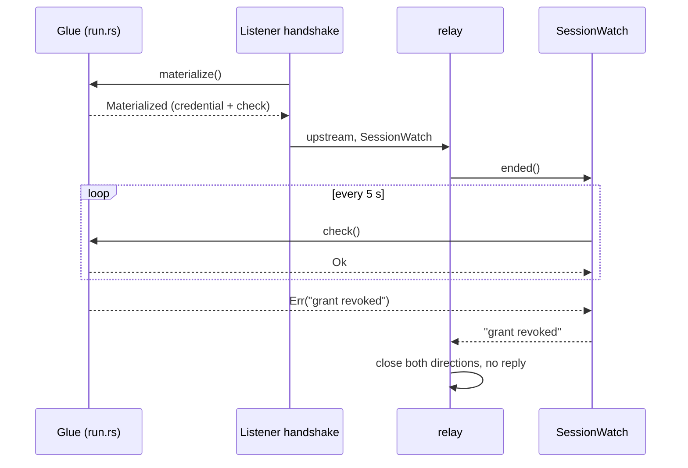

# One session-end contract for the four database relays

Status: accepted 2026-11-15. The owner accepted D1 to D5 as recommended. No code is changed.

Do not push this spec while finding 0.1 of the 0.6.0 security review is open: it describes that
finding. This repository is public.

## Problem

An open PostgreSQL, MySQL, MongoDB or Redis session must end when its grant ends. Two plans of
2026-11-15 add this rule, each in its own way, to the same four relay loops:

| | Security-review plan, Task 2 | Read-only database access plan, T2 and T3 |
|---|---|---|
| Mechanism | Poll: a `Revalidate` closure, called every 5 s | Push: a `SessionEnd` watch channel that the agent fires |
| How the relay gets it | A new builder method `with_revalidate` on each listener | A new field of the value that `Materialize` returns |
| Audit reason | `grant revoked` | `grant ended` or `access changed` |
| New agent state | None | `SessionEpochs`, one channel for each resource, one lock |
| Guard against a forgotten listener | A test that counts `with_revalidate(` in the source text | None |

If both plans land as written, each relay has two branches for one event, with two reasons, and
the agent has two paths that must both fire.

The cause is older than both plans. Each session rule has one copy for each protocol crate:

| Rule | Copies | Where |
|---|---|---|
| Caller check at accept, fail closed (ADR-0052) | 4, the same text | `serve` in `zs-proto-redis/src/lib.rs:191`, `zs-proto-mongo/src/lib.rs:200`, `zs-proto-mysql/src/lib.rs:200`; `serve_with` in `zs-proto-postgres/src/lib.rs:1801` |
| `AuditRefusal` type | 4, the same text | `zs-proto-redis/src/lib.rs:21`, `zs-proto-mongo/src/lib.rs:26`, `zs-proto-mysql/src/lib.rs:26`, `zs-proto-postgres/src/lib.rs:1451` |
| Grant re-check interval | 1 today (`zs-mitm/src/websocket.rs:15`), 2 after the security plan | The WebSocket relay already re-checks every 5 s |
| Grant re-check on an open session | 0 today | Finding 0.1 |

A rule with four copies is missing from the fifth protocol, or from one of the four after a
change. Finding 0.1 is that failure.

## Goals

- One mechanism ends a database session when its grant ends or changes. Both plans use it.
- A listener cannot get a credential without also getting the check for its session. The glue
  has one place to build both, not four builder calls.
- The interval, the check type and the wait loop have one copy.
- The fix for finding 0.1 does not become larger or later than the security plan's Task 2.

## Non-goals

- No shared relay loop. The four loops stay in their crates (approach B, below).
- No change to the handshake code, the frame filters or the echo guards.
- No change to `zs_proto_postgres::CancelAuthorize`. A CancelRequest opens no session.
- No change to the WebSocket relay other than the constant it reads.
- The read-only enforcement itself. Its spec owns it.

## Approaches

| Approach | What it does | Cost (estimate) | Trade-off |
|---|---|---|---|
| A. The check travels with the credential (recommended) | `Materialize` returns the credential and a session check. One shared future polls it. Each relay adds one branch | About 1.5 days. It replaces Task 2 of the security plan and the session-end parts of T2 and T3 of the read-only plan | Each relay still owns its loop, so a relay can still ignore the check. The compiler and four tests guard that |
| B. One generic relay driver | A new type owns accept, handshake budget, the relay `select!`, the endings and the events. Each protocol crate implements a trait | 1 to 2 weeks | The four loops are not the same shape: PostgreSQL uses two spawned tasks and `abort`; Redis co-ordinates a refusal drain between its halves; MongoDB has a third branch for a primary step-down; MySQL attributes a close with a quit flag. One driver needs a hook for each. The risk is in the code that the security claims rest on, and the fix for 0.1 waits |
| C. Both plans as written | Poll and push, side by side | 0 now | Two mechanisms, two reasons, eight relay edits, and the agent must fire the push on every path |

A is recommended. Poll is enough: the read-only plan pins "open sessions close within 5 s of the
agent learning", which is the poll interval. Poll reads the current grant on each tick, so the
agent has no path to forget and no state to keep. The WebSocket relay already works this way.

B stays possible later. Do it when a fifth database protocol or a third session rule arrives.

## Design

### Types in `zs-protocol`

The types below are always present. A new cargo feature `session` holds the two `async`
functions, `SessionWatch::ended` and `admitted`, so that `zs-policy` and `zs-proto-http` do not get
`tokio`. The four relay crates and `zs` enable it.

```rust
pub const REVALIDATE_EVERY: std::time::Duration = std::time::Duration::from_secs(5);

pub type SessionCheck = std::sync::Arc<dyn Fn() -> Result<(), &'static str> + Send + Sync>;

pub struct Materialized {
    credential: Credential,
    check: SessionCheck,
}

impl Materialized {
    pub fn new(credential: Credential, check: SessionCheck) -> Self;
    pub fn into_parts(self) -> (Credential, SessionWatch);
}

#[must_use]
pub struct SessionWatch {
    check: SessionCheck,
}

impl SessionWatch {
    pub async fn ended(self) -> &'static str;
}

pub type Materialize = std::sync::Arc<dyn Fn() -> Result<Materialized, Denied> + Send + Sync>;

pub type AuditRefusal =
    std::sync::Arc<dyn Fn(&'static str, &'static str) -> Option<u64> + Send + Sync>;

pub async fn admitted(
    check: Option<&CallerCheck>,
    client: &tokio::net::TcpStream,
    peer: std::net::SocketAddr,
) -> bool;
```

Rules:

- The fields of `Materialized` are private. `into_parts` is the only way to the credential, so a
  listener that takes the credential also holds the `SessionWatch`.
- `SessionWatch::ended` makes `tokio::time::interval_at(now + REVALIDATE_EVERY, REVALIDATE_EVERY)`
  and calls the check on each tick. It returns the reason of the first `Err`. It never returns
  while the check returns `Ok`. The first check runs 5 s after the relay starts.
- The reason is a fixed `&'static str`. The check cannot return text that holds an argument.
- `admitted` is the accept gate that each `serve` has today: it runs the caller check in
  `spawn_blocking` and returns `false` when there is no check, no local address or a panic.
  Each crate keeps its own `caller_refused` event.
- Each relay crate re-exports `Materialize` and `AuditRefusal`, so the paths that the glue uses
  today stay valid.
- `zs-mitm/src/websocket.rs` reads `zs_protocol::REVALIDATE_EVERY` and loses its own constant.

### The relay rule

Each of the four `relay` functions adds one branch to its `select!` and one ending:



On that ending the relay:

1. Writes no byte to the client and no byte to the upstream. It drops both halves. PostgreSQL
   aborts both copy tasks.
2. Calls its refusal audit with the operation `connect` and the reason from `ended`.
3. Emits `client_refused` with the code `revoked` and the audit sequence number.
4. Emits `conn_closed` with `closed_by` `revoked`.

A session that ends for another cause drops the `SessionWatch` with the relay.

### The glue

`l3_materialize` in `apps/zs/src/run.rs` is the one place that builds a `Materialized`. It builds
the check beside the credential:

- The check calls `handler.authorize_message(resource, "connect")`, the same call that a
  CancelRequest and the WebSocket relay use. It covers revocation, signature, expiry and the
  connection match. A renewed grant keeps the session open, because the call reads the current
  grant of the resource.
- A denial maps to the fixed reason `grant revoked`.
- The four listener builds do not change. There is no `with_revalidate` to forget.

### What the read-only plan adds later

- `Materialized` gets a third private field `access`, a third argument of `new`, and a getter.
- The check closure also compares the access of the current grant with the access that the
  session started with. A difference returns `access changed`.
- `SessionEnd`, `SessionEpochs` and `session_epoch.rs` are not built.

## Effect on the two plans

| Plan item | Change |
|---|---|
| Security plan, Task 1 (ADR) | Same decision. Add one sentence: the check reaches the relay with the credential, not through a builder method |
| Security plan, Task 2, interfaces | `Revalidate`, `with_revalidate` and `listen_revalidated` are not built. `Materialized`, `SessionCheck` and `SessionWatch` replace them |
| Security plan, Task 2, steps 1 to 3 | Same four tests. `grant_state()` returns a `Materialize` whose check reads the flag. The fake `listen` helpers keep their signatures |
| Security plan, Task 2, steps 5 and 7 | The third branch awaits `SessionWatch::ended`. No `Option`, no `std::future::pending` |
| Security plan, Task 2, step 9 | The source-text count test is not written. The glue has one construction site |
| Security plan, Task 2, step 10 | Same document changes |
| Read-only plan, T2 | Only `SessionAccess` and the `access` field of `Materialized`. The six `session_epoch` tests become three tests of the check closure: a renewal with another access returns `access changed`; a renewal with the same access returns `Ok`; a session opened after the change returns `Ok` |
| Read-only plan, T3 | No relay change. The two tests stay (close within 5 s, pool reconnect) |
| Read-only plan, audit reason | `grant ended` becomes `grant revoked` (D2) |

## Tests

| Test | Proves |
|---|---|
| The four `session_ends_with_grant.rs` files (the saved failing tests) | A session ends within two intervals of the check failing, with no reply and with the audit record. Each keeps its two controls |
| In each of the four: a command with the marker `still-granted` after 6 s, while the check returns `Ok` | A valid session survives a tick. A pool does not lose its connections every 5 s |
| `zs-protocol`: `ended_returns_the_first_reason`, `ended_waits_one_interval_before_the_first_check`, `ended_does_not_return_while_the_check_passes` (paused tokio time) | The wait loop, in its one copy |
| `zs-protocol`: `admitted_is_false_without_a_check` | The accept gate fails closed |
| `apps/zs`: `the_session_check_denies_after_revocation` and `the_session_check_passes_after_renewal`, on the closure that `l3_materialize` builds | The glue builds a real check, not a constant `Ok` |

A relay that drops its `SessionWatch` without awaiting it fails the first row for its protocol.
It also needs a `_` pattern or a name that starts with `_` to compile without a warning; a
reviewer refuses that.

## Decisions for the owner

| Id | Question | Recommendation |
|---|---|---|
| D1 | Approach A, B or C? | A |
| D2 | One audit reason for revocation and expiry: `grant revoked` (security plan, and the WebSocket relay's `Ended::Revoked`) or `grant ended` (read-only plan)? | `grant revoked`. It is already in the security plan's ADR text |
| D3 | The helpers need `tokio`. Put them in `zs-protocol` behind a feature `session`, or in a new crate? | The feature. A new crate needs an entry in the crate order of ARCHITECTURE §2 and in the five tests that enforce it |
| D4 | Include the accept gate (`admitted`) and the single `AuditRefusal` in this change, or only the session check? | Include them. They are the same four files and about 40 deleted lines |
| D5 | The check runs on a runtime worker, as the WebSocket check does. Accept that, or require `spawn_blocking`? | Accept. It is one grant check for each session every 5 s. Measure it before a host carries more than about 1000 open sessions |

## Not in this spec

- The 15 s handshake budget has four copies too. It has not failed, and MongoDB and Redis make
  it a builder option. Leave it.
- The `Conn` event helpers (`event`, `refused`, `closed`) are close to the same in three crates.
  They are diagnostics, not a security rule. Leave them until approach B.

## Verification

1. `cargo test -p zs-protocol --features session`, then `cargo test -p <crate>` for the four
   relay crates, `zs-mitm` and `zs`: all pass.
2. `grep -rn 'with_revalidate\|SessionEpochs\|listen_revalidated' crates apps` returns nothing.
3. `grep -rn 'REVALIDATE_EVERY: ' crates apps` returns one line, in `zs-protocol`.
4. `grep -rn 'pub type AuditRefusal' crates` returns one line, in `zs-protocol`.
5. The clippy command of AGENTS.md passes for the workspace.
